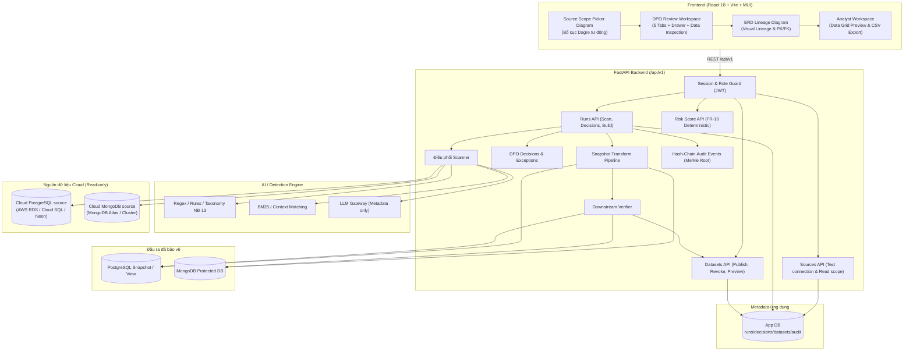
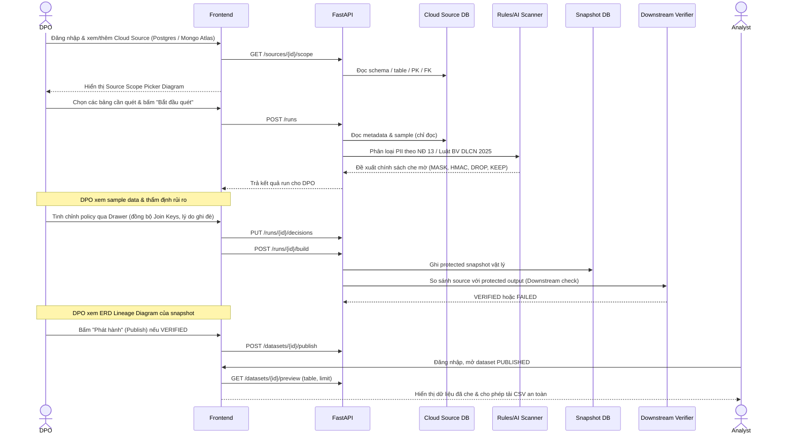

# PIIGuard Shield - Kiến Trúc Hệ Thống

Tài liệu này là bản tóm lược kiến trúc của PIIGuard Shield. Bản chi tiết hơn nằm ở [docs/core/SYSTEM_ARCHITECTURE.md](docs/core/SYSTEM_ARCHITECTURE.md).

## 1. Tổng Quan

PIIGuard Shield giúp DPO (Data Protection Officer) tự động quét, đánh giá rủi ro và tạo một dataset đã được bảo vệ trước khi chia sẻ cho Analyst.

Luồng P0:

```text
Cloud PostgreSQL / MongoDB Atlas source
  -> scanner phát hiện PII (Rules/Regex + AI/LLM)
  -> rules/agent đề xuất action (MASK, HMAC, DROP, KEEP)
  -> DPO xem data, thẩm định rủi ro & phê duyệt (HITL)
  -> build protected snapshot vật lý
  -> verifier kiểm tra tính toàn vẹn (SQL JOIN / $lookup / aggregate)
  -> publish cho Analyst sử dụng an toàn
```

Hệ thống hỗ trợ các cơ sở dữ liệu **PostgreSQL và MongoDB lưu trữ trên Cloud** (Cloud SQL, AWS RDS, Supabase, Neon, MongoDB Atlas) và cho phép kết nối động qua Connection URL (`postgresql://`, `mongodb+srv://`).

## 2. Sơ Đồ Kiến Trúc



## 3. Trách Nhiệm Từng Thành Phần

| Thành phần | File chính | Trách nhiệm |
| --- | --- | --- |
| **Frontend** | `front_end/src/` | Giao diện DPO (5 Tabs, Scope Picker Diagram, ERD Lineage, Policy Drawer) & Analyst (Data Grid, CSV Export). Kết nối API thật qua `realPiiReviewApi.ts`. |
| **API** | `src/api/` | REST endpoints, JWT auth, kiểm tra role DPO/Analyst và trạng thái pipeline. |
| **App DB** | `src/db/` | Chỉ lưu metadata: source config, run, decision, dataset, verifier result, hash-chain audit log. |
| **Models** | `src/models/schemas.py` | Pydantic contract giữa API, scanner và FE. |
| **Connectors** | `src/connectors/` | Kết nối Cloud PostgreSQL / MongoDB đọc schema/profile/scope an toàn. |
| **Detection** | `src/detection/` | Regex, rules, taxonomy NĐ 13 / Luật BV DLCN 2025, BM25 context. |
| **Agent / LLM** | `src/agents/`, `src/services/llm.py` | Hỗ trợ phân loại các trường mập mờ; prompt chỉ nhận metadata và thống kê. |
| **Transform** | `src/transform/` | Áp dụng MASK, DROP, HMAC, KEEP vào snapshot vật lý đích. |
| **Verifier** | `src/verifier/` | Kiểm tra SQL JOIN / aggregate hoặc Mongo `$lookup` trước khi publish. |
| **Eval** | `eval/` | Golden labels, expected downstream, báo cáo precision/recall. |

## 4. Luồng Dữ Liệu & Phê Duyệt



## 5. Nguyên Tắc Bảo Mật & Phân Quyền Bất Di Bất Dịch

1. **Nguyên tắc đối với DPO:**
   * DPO là người chịu trách nhiệm pháp lý và thẩm định rủi ro tuân thủ. **DPO CÓ THỂ XEM DATA (Sample data / Preview / Split view)** trong quá trình review để đánh giá đúng mức độ rủi ro, phân loại PII chính xác và xác thực các trường mơ hồ (`UNKNOWN`).
   * Mọi quyết định ghi đè gợi ý của AI hoặc giữ nguyên cột PII (ngoại lệ) bắt buộc phải nhập lý do và được ghi vào Sổ cái kiểm toán bất biến (Hash-Chain Merkle Root).
2. **Nguyên tắc đối với Analyst:**
   * **Zero Raw-PII cho Analyst:** Analyst tuyệt đối không bao giờ được xem dữ liệu PII thô. Analyst chỉ được truy cập các dataset ở trạng thái `PUBLISHED` (đã qua MASK, HMAC, DROP).
3. **Bảo mật cơ sở dữ liệu:**
   * Nguồn Cloud PostgreSQL và MongoDB luôn ở chế độ chỉ đọc (read-only).
   * Snapshot/protected output được ghi vào database hoặc schema đích riêng biệt.
   * API tuyệt đối không trả connection URI chứa mật khẩu, credential, hoặc khóa HMAC bí mật ra ngoài frontend.
4. **Tính toàn vẹn liên kết (Join Key Integrity):**
   * Các cặp trường là khóa nối giữa các bảng (PK/FK hoặc `$lookup`) bắt buộc phải áp dụng cùng hành động (`HMAC` hoặc `KEEP`). Không được phép áp dụng `MASK` hoặc `DROP` làm phá vỡ quan hệ liên kết dữ liệu.
5. **Cổng chặn phát hành:**
   * Backend chặn phát hành nếu Downstream Verifier chưa đánh dấu `VERIFIED`.

## 6. Mô Hình Triển Khai

* **Data Sources:** Cơ sở dữ liệu Cloud PostgreSQL (AWS RDS, GCP Cloud SQL, Supabase, Neon) và Cloud MongoDB Atlas.
* **Backend:** FastAPI, Python 3.11+, SQLAlchemy, PyMongo, Pydantic v2.
* **Frontend:** React 18, TypeScript strict, Vite, MUI, `@xyflow/react` (React Flow) với thuật toán bố cục `dagre`.
* **CI/CD & Demo:** Hỗ trợ chạy cục bộ qua Docker Compose và triển khai cloud (Render, Cloud Run, Cloud SQL).
