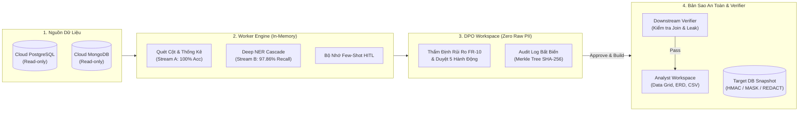

# PIIGuard Shield - Tổng Quan Kiến Trúc (Architecture Overview)

**PIIGuard Shield** là nền tảng tự động phát hiện, phân loại PII (theo **Nghị định 13/2023/NĐ-CP** và **Luật 91/2025/QH15**) và tạo bản sao dữ liệu an toàn (Protected Snapshot) cho đội ngũ Phân tích dữ liệu (Analyst) và AI mà không làm lộ dữ liệu cá nhân thô.

> [!NOTE]
> Đây là bản tóm lược kiến trúc cấp cao (High-Level Architecture). Để xem toàn bộ chi tiết kỹ thuật từng module, vui lòng tham khảo:
> * 📖 [**Kiến trúc Hệ thống Chi tiết (System Architecture)**](docs/core/SYSTEM_ARCHITECTURE.md)
> * 🤖 [**Kiến trúc Mô hình AI & NER Cascade (AI Architecture)**](docs/core/AI_ARCHITECTURE.md)
> * 📊 [**Báo cáo Nghiệm thu Phase 1 (MVP Status Report)**](docs/core/MVP_STATUS_REPORT.md)
> * 🔀 [**Sơ đồ Luồng Che mờ PII Đa tầng (Redaction Flowchart)**](docs/pii_redaction_flowchart.md)

---

## 1. Luồng Vận Hành Cấp Cao (High-Level Architecture)

---

## 2. Ba Trụ Cột Thiết Kế Cốt Lõi

### ① Nguyên Tắc Zero Raw PII & Tách Bạch Vai Trò
* **DPO (Governance):** Thao tác trên Web UI, thẩm định rủi ro dựa trên siêu dữ liệu (metadata), kiểu dữ liệu và phân phối thống kê (`column_stats.py`). DPO **không được cấp quyền truy cập CSDL nguồn** (Least Privilege).
* **Worker Engine:** Kết nối nguồn qua Service Account độc lập, quét và biến đổi dữ liệu hoàn toàn trên **RAM (In-Memory Streaming)**, không lưu vết thô ra ổ đĩa hay log.
* **CSDL Đích (Snapshot):** Chỉ lưu trữ dữ liệu đã được ẩn danh vĩnh viễn (`HMAC`, `REDACT`, `MASK`, `DROP`). DPO hay Analyst truy cập DB đích cũng chỉ xem được dữ liệu đã bảo vệ, loại bỏ triệt để nguy cơ rò rỉ nội bộ.

### ② Khoét Sâu Dữ Liệu (Deep Content Inspection) Song Hành Bảo Mật
* **Luồng A (Dữ liệu bảng cấu trúc):** Kết hợp Regex, từ điển pháp lý NĐ 13 và LLM LangGraph. Đạt **100.00% Action Accuracy** trên 339 cột sau khi tích hợp bộ nhớ few-shot DPO.
* **Luồng B (Văn bản tự do):** Cascade đa tầng (Regex $\rightarrow$ FlashText $\rightarrow$ GLiNER Multi-PII zero-shot), đạt **97.86% Recall** và 97.51% F1 để bóc tách PII ẩn giấu trong ghi chú, chat log.
* **Trừu tượng hóa an toàn:** AI đọc sâu trong RAM nhưng chỉ trả về loại thực thể (`PER`, `PHONE`) và tỷ lệ phát hiện. DPO kiểm chứng qua **Live Sandbox** bằng dữ liệu giả lập (Synthetic Data) mà không cần xem văn bản thật của khách hàng.

### ③ Chiến Lược Che Mờ 5 Hành Động (Không Che Thô `***`)
Bảo toàn tối đa giá trị khai thác dữ liệu (**Data Utility**) mà không đánh đổi bảo mật:

| Hành động | Bản chất kỹ thuật | Giá trị phân tích (Tại sao không che `***`?) |
| :--- | :--- | :--- |
| **`HMAC`** | Băm 1 chiều kèm Secret Salt | Giữ nguyên quan hệ khóa liên kết (`join_matched`), **tránh nổ tích Đề-các (Cartesian join)** làm sập DB phân tích. |
| **`REDACT`** | Thay thực thể bằng nhãn (`[PHONE]`) | Giữ nguyên cấu trúc ngữ pháp cho đội AI/LLM phân tích ngữ nghĩa, phân loại khiếu nại và sentiment. |
| **`MASK`** | Che đoạn giữa (`0912***789`) | Giữ đặc trưng thống kê (thị phần nhà mạng, domain email cá nhân vs DN, nhóm tuổi). |
| **`DROP`** | Xóa hẳn cột khỏi snapshot | Loại bỏ hoàn toàn trường dữ liệu nặng và rủi ro cao (ảnh CCCD, sinh trắc học). |
| **`KEEP`** | Giữ nguyên giá trị | Áp dụng cho các trường phi cá nhân (doanh thu, ngày tạo đơn) để đảm bảo số liệu báo cáo chuẩn xác. |

---

## 3. Tổng Quan Tech Stack

| Tầng | Công nghệ sử dụng | Vai trò chính |
| :--- | :--- | :--- |
| **Frontend** | React 18, TypeScript Strict, Vite, MUI, React Flow (`@xyflow/react`), Dagre Layout | Giao diện DPO 4 Tabs, Source Scope Picker, Live Sandbox, Visual Lineage ERD |
| **Backend API** | FastAPI, Python 3.11+, Pydantic v2, SQLAlchemy, PyMongo | REST API, Role-based Access Control (`require_dpo`, `require_analyst_or_dpo`) |
| **AI & Detection** | GLiNER (`urchade/gliner_multi_pii-v1`), FlashText, LangGraph, Few-Shot Memory | Quét mẫu PII, nhận diện thực thể văn bản tự do, học phản hồi DPO (HITL) |
| **Storage & Snapshot** | Cloud PostgreSQL (RDS/Cloud SQL/Supabase/Neon), Cloud MongoDB Atlas | Lưu trữ nguồn đọc (Source) và CSDL đích an toàn (Snapshot) |
| **Kiểm Định & Audit** | Merkle Tree (SHA-256 Hash Chain), SQL/Mongo Downstream Verifier | Kiểm tra tính toàn vẹn JOIN/Leak trước khi Publish; Chống chối bỏ theo NĐ 13 |

---

## 4. Tài Liệu Kỹ Thuật Tham Chiếu

1. [Kiến Trúc Hệ Thống Chi Tiết (SYSTEM_ARCHITECTURE.md)](docs/core/SYSTEM_ARCHITECTURE.md)
2. [Kiến Trúc Mô Hình AI & NER Cascade (AI_ARCHITECTURE.md)](docs/core/AI_ARCHITECTURE.md)
3. [Đặc Tả Yêu Cầu Sản Phẩm (PRD.md)](docs/core/prd.md)
4. [Báo Cáo Nghiệm Thu Hoàn Thành Phase 1 (MVP_STATUS_REPORT.md)](docs/core/MVP_STATUS_REPORT.md)
5. [Kịch Bản Trình Diễn MVP 6 Bước (DEMO_FLOW.md)](docs/guide/DEMO_FLOW.md)
