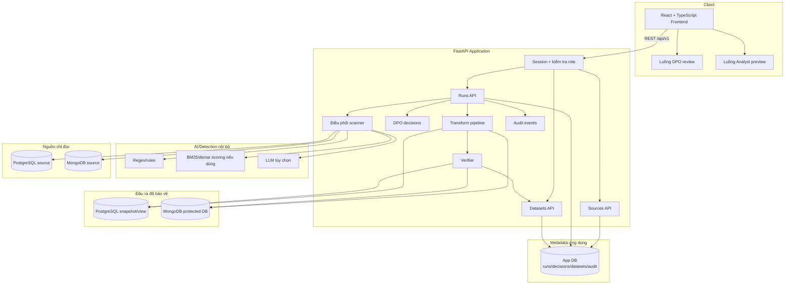
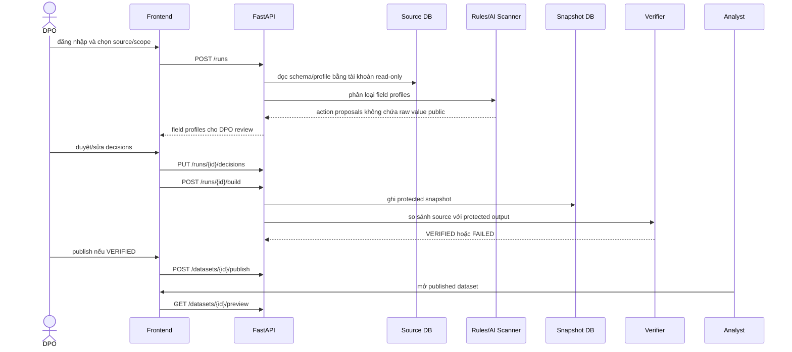
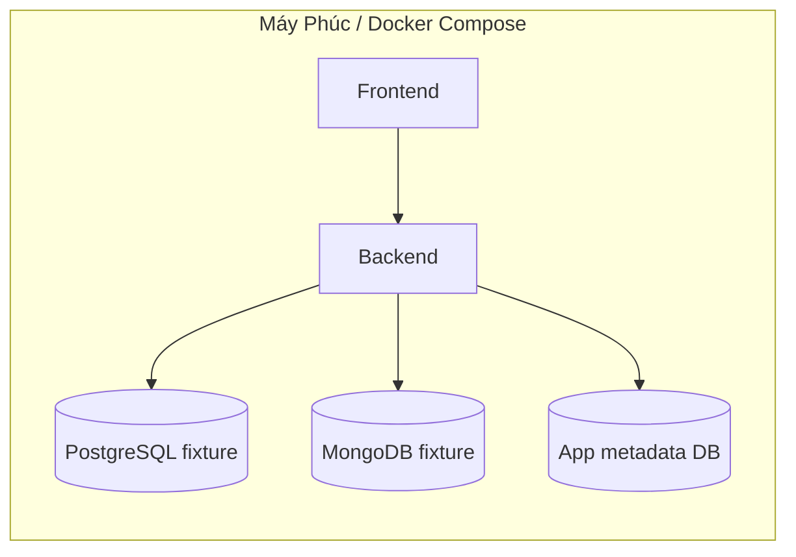

# PIIGuard VN - Kiến Trúc Hệ Thống

Tài liệu này là bản kiến trúc ngắn gọn của PIIGuard VN. Bản chi tiết hơn nằm ở [docs/SYSTEM_ARCHITECTURE.md](docs/SYSTEM_ARCHITECTURE.md).

## 1. Tổng Quan

PIIGuard VN giúp DPO tạo một dataset đã được bảo vệ trước khi chia sẻ cho Analyst.

Luồng P0:

```text
PostgreSQL/MongoDB source
  -> scanner phát hiện PII
  -> rules/agent đề xuất action
  -> DPO duyệt
  -> build protected snapshot
  -> verifier kiểm tra JOIN/$lookup/aggregate
  -> publish cho Analyst
```

P0 chỉ cam kết PostgreSQL và MongoDB. Kiến trúc có connector contract để mở rộng sau, nhưng không hứa rằng MVP có thể "ném bất cứ database nào vào cũng chạy".

## 2. Sơ Đồ Kiến Trúc



## 3. Trách Nhiệm Từng Thành Phần

| Thành phần | File chính | Trách nhiệm |
| --- | --- | --- |
| Frontend | `front_end/src/` | UI cho DPO/Analyst, gọi backend API, không tự gánh bảo mật |
| API | `src/api/` | REST endpoints, auth, kiểm tra role và trạng thái |
| App DB | `src/db/` | Chỉ lưu metadata: source config, run, decision, dataset, verifier result, audit |
| Models | `src/models/schemas.py` | Pydantic contract giữa API, scanner và FE |
| Connectors | `src/connectors/` | Đọc schema/profile/batch từ PostgreSQL hoặc MongoDB |
| Detection | `src/detection/` | Regex, rules, taxonomy, BM25 support |
| Agent | `src/agents/`, `src/services/llm.py` | Luồng LLM tùy chọn cho field mơ hồ |
| Transform | `src/transform/` | Áp dụng MASK, DROP, HMAC, KEEP vào protected output |
| Verifier | `src/verifier/` | Kiểm tra SQL JOIN/aggregate hoặc Mongo `$lookup` trước khi publish |
| Eval | `eval/` | Golden labels, expected downstream, reports |

## 4. Luồng Dữ Liệu



## 5. Ranh Giới Contract FieldProfile

Detector nội bộ được dùng sample để tính regex/rules/BM25. Nhưng API/UI/LLM chỉ được thấy bản đã lọc.

```text
InternalFieldProfile
  có sample_values giới hạn
  chỉ dùng trong connector/scanner nội bộ

PublicFieldProfile
  không có raw sample_value
  trả về API/UI/app DB

LLMFieldProfile
  không có raw sample_value
  chỉ có path/type/statistics/pattern/data shape đã lọc
```

Output đề xuất không bắt buộc có một `confidence` chung. Nên lưu rõ:

- `classification`
- `action_proposal`
- `reason`
- `decision_tier`: `regex`, `retrieval`, `llm`, `human_review`
- `evidence_scores`: regex matched, BM25 score, dense score nếu có
- `provider_metadata` đã lọc: model/provider nếu có LLM

## 6. Quy Tắc Bảo Mật

- Source database là read-only.
- Snapshot/protected output nằm ở schema/database riêng.
- DPO và Analyst không bao giờ thấy raw PII.
- Prompt LLM không bao giờ nhận raw sample values.
- API không trả database URI, password, HMAC secret, API key hoặc raw source values.
- Analyst chỉ đọc dataset `PUBLISHED`.
- Backend chặn publish nếu verifier chưa đánh dấu dataset `VERIFIED`.
- HMAC là keyed hash một chiều, không phải encryption.

## 7. Mô Hình Deploy

### Demo Gate 2



Gate 2 deploy theo hướng demo local trước: Docker Compose, synthetic fixture, không dùng dữ liệu thật.

### Hướng doanh nghiệp

PIIGuard nên chạy gần dữ liệu của khách hàng:

- server nội bộ/on-premise; hoặc
- private cloud/VPC do doanh nghiệp sở hữu.

Doanh nghiệp cung cấp read-only source credentials và một snapshot target riêng. PIIGuard không yêu cầu người dùng upload raw database dump lên một dịch vụ public bên ngoài.

## 8. Quyết Định Thiết Kế

| Quyết định | Lựa chọn | Lý do |
| --- | --- | --- |
| Backend | FastAPI + Pydantic | API contract rõ, Swagger tiện, hợp xử lý dữ liệu bằng Python |
| Frontend | React + TypeScript + Vite | Dashboard app, không cần SSR |
| P0 databases | PostgreSQL + MongoDB | Một nhánh SQL và một nhánh NoSQL có verifier thật |
| AI | Rules-first, LLM tùy chọn cho field mơ hồ | Dễ kiểm soát, ít rủi ro, đo được so với baseline rules-only |
| Vector store | Không thuộc P0 | Taxonomy nhỏ; BM25/dense scoring có thể dùng nội bộ nhưng không cần Chroma/RAG legal store |
| Protection | MASK/DROP/HMAC/KEEP | Đủ cho MVP và verifier-friendly |
| Deployment | Docker Compose cho demo, on-prem/private cloud cho hướng doanh nghiệp | Giữ dữ liệu nhạy cảm trong môi trường của khách hàng |
