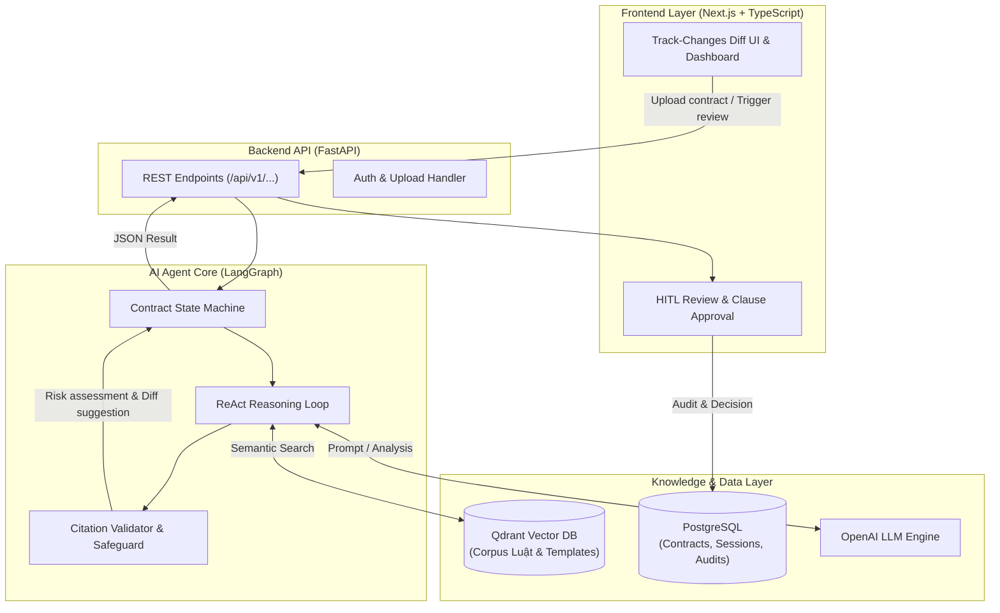

# ContractGuard AI — Hệ Thống AI Agent Rà Soát Hợp Đồng & Cảnh Báo Rủi Ro Pháp Lý

> **Mã đội:** P-138 · **Khoá:** VinUni AI20K Build Phase (Cohort 4)  
> **Tóm tắt 1 câu:** Tự động hoá rà soát hợp đồng, đối chiếu corpus pháp luật & template mẫu, cảnh báo rủi ro pháp lý và đề xuất sửa đổi trực quan (track-changes diff UI) cho doanh nghiệp và đội ngũ pháp chế.

[](https://github.com/AI20K-Build-Phase-Cohort-4/P-138/actions/workflows/ci.yml)
[](https://www.python.org/downloads/release/python-3110/)
[](https://fastapi.tiangolo.com)
[](https://langchain-ai.github.io/langgraph/)
[](LICENSE)

---

## 1. Vấn đề (Problem Statement)

Tại các doanh nghiệp vừa và nhỏ (SME), startup và các phòng ban vận hành (Mua sắm, Kinh doanh, Nhân sự), hợp đồng thương mại, dịch vụ và lao động liên tục được khởi tạo và ký kết:

- **Thiếu nhân sự pháp chế chuyên trách (in-house legal):** Phần lớn SME không có luật sư nội bộ hoặc bộ phận pháp chế luôn trong tình trạng quá tải, dẫn đến việc rà soát hợp đồng bị chậm trễ từ 3–7 ngày làm việc.
- **Dễ bỏ sót điều khoản bất lợi & rủi ro tiềm ẩn:** Rà soát thủ công dễ bỏ sót các "bẫy" pháp lý: phạt vi phạm vượt mức trần luật định (ví dụ: quá 8% theo Luật Thương mại), điều khoản bồi thường thiệt hại vô hạn, quyền đơn phương chấm dứt hợp đồng bất bình đẳng, điều khoản bất khả kháng thiếu chặt chẽ, hoặc cơ quan tài phán/trọng tài bất lợi.
- **Hạn chế của giải pháp truyền thống & LLM thông thường:** Các công cụ regex/từ khoá không hiểu ngữ cảnh pháp lý; trong khi dùng ChatGPT/LLM thuần túy dễ gặp tình trạng ảo giác (hallucination), bịa đặt số điều luật, không kiểm chứng được trích dẫn (citation) và không tích hợp sâu vào quy trình phê duyệt doanh nghiệp (HITL).

---

## 2. Giải pháp (Solution)

**ContractGuard AI** là một hệ sinh thái AI Agent toàn diện hỗ trợ rà soát, đánh giá rủi ro và đề xuất hiệu chỉnh hợp đồng theo nguyên tắc **"AI phân tích sâu, Agent kiểm chứng chéo, Con người phê duyệt (Human-in-the-Loop)"**:

- **Phân tích điều khoản chuyên sâu (Clause-level Analysis):** Bóc tách cấu trúc hợp đồng thành từng điều khoản độc lập, phân loại và đánh giá mức độ rủi ro (Cao / Trung bình / Thấp) theo chuẩn rubric pháp lý.
- **RAG pháp luật & Checklist rủi ro (Qdrant Vector DB):** Đối chiếu nội dung hợp đồng với kho template hợp đồng mẫu chuẩn, checklist rủi ro theo từng loại giao dịch, và corpus văn bản quy phạm pháp luật Việt Nam (Bộ luật Dân sự, Luật Thương mại, Luật Doanh nghiệp...).
- **Cơ chế xác thực trích dẫn (Citation Validator & Safeguards):** Agent kiểm tra chéo từng điều luật được trích dẫn để chặn hoàn toàn lỗi ảo giác viện dẫn sai luật; tự động kích hoạt fallback khi độ tin cậy thấp.
- **Giao diện Track-Changes Diff trực quan (Next.js):** Hiển thị trực quan điều khoản gốc bên cạnh điều khoản đề xuất sửa đổi (redline diff giống tính năng Track Changes trong Word), giúp người dùng dễ dàng so sánh và đưa ra quyết định.
- **Human-in-the-loop (HITL) Workflow:** Cho phép Chuyên viên / PO duyệt (`Accept` / `Reject` / `Edit`) từng đề xuất trước khi kết xuất văn bản cuối cùng kèm báo cáo tóm tắt rủi ro (Risk Summary Report).

---

## 3. Người dùng mục tiêu (Target Users)

- **Người dùng chính (Primary Persona):**
  - **Chuyên viên Pháp chế / Legal Counsel:** Cần công cụ trợ lực (copilot) để quét nhanh hàng chục trang hợp đồng, lọc ra các điểm bất thường và đối chiếu luật định chuẩn xác trong vài chục giây.
  - **Founder / Giám đốc điều hành SME:** Cần nắm bắt nhanh mức độ rủi ro, nghĩa vụ tài chính và trách nhiệm pháp lý cốt lõi trước khi đặt bút ký.
- **Người dùng phụ (Secondary Persona):**
  - **Trưởng bộ phận Mua hàng (Procurement) / Kinh doanh (Sales):** Cần rà soát sơ bộ bản thảo hợp đồng nhận từ đối tác trước khi chuyển giao cho cấp thẩm quyền phê duyệt.

---

## 4. Tech Stack

| Thành phần               | Công nghệ                          | Chi tiết sử dụng                                                                |
| ------------------------ | ---------------------------------- | ------------------------------------------------------------------------------- |
| **AI Agent**             | LangGraph + LangChain 0.3          | StateGraph, ReAct loop, tool calling, conditional routing, safeguards           |
| **LLM Provider**         | OpenAI (`gpt-4o-mini`, `gpt-4o`)   | Trích xuất điều khoản, giải thích rủi ro, đề xuất chỉnh sửa văn phong           |
| **Vector DB / RAG**      | Qdrant                             | Lưu trữ & tìm kiếm ngữ nghĩa corpus pháp luật, checklist rủi ro, template chuẩn |
| **Backend API**          | FastAPI 0.115+ (Python 3.11)       | RESTful API bất đồng bộ (async), Pydantic v2 schemas, streaming responses       |
| **Database**             | PostgreSQL                         | Quản lý hợp đồng, phiên rà soát, lịch sử audit log và phản hồi người dùng       |
| **Frontend**             | Next.js 14+ (React 19, TypeScript) | Giao diện tương tác, Redline/Track-Changes diff UI, bảng đánh giá rủi ro        |
| **CI / CD & DevOps**     | Docker, GitHub Actions             | Multi-stage build Dockerfile, docker-compose, CI ruff linter + pytest           |
| **Monitoring & Logging** | LangSmith & AI Usage Hooks         | AI prompt logging tự động lên Phoenix server, LangSmith trace agent reasoning   |

---

## 5. Kiến trúc hệ thống (System Architecture)



---

## 6. Quick Start

```bash
# 1. Clone repo
git clone https://github.com/AI20K-Build-Phase-Cohort-4/P-138.git
cd P-138

# 2. Setup environment
python3.11 -m venv .venv
source .venv/bin/activate      # Windows: .venv\Scripts\activate
cp .env.example .env
# Edit .env with your API keys (OPENAI_API_KEY, AI_LOG_API_KEY)

# 3. Install dependencies
pip install -r requirements.txt

# 4. Setup AI logging hooks
bash scripts/setup_hooks.sh

# 5. Run development server
uvicorn src.main:app --reload
```

---

## 7. Cấu trúc thư mục dự án (Project Structure)

```text
P-138/
├── src/
│   ├── agents/                   # LangGraph Agent Core
│   │   ├── graph.py              # StateGraph (nodes, conditional edges)
│   │   ├── state.py              # AgentState TypedDict schema
│   │   ├── nodes/                # Node functions (bóc tách, phân tích, đối chiếu)
│   │   └── tools/                # Tools (tra cứu Qdrant, citation validator)
│   ├── api/
│   │   └── routes.py             # FastAPI routes (/chat, /analyze, /status)
│   ├── models/
│   │   └── schemas.py            # Pydantic request & response schemas
│   ├── services/
│   │   └── llm.py                # LLM client & OpenAI integration
│   ├── config.py                 # Pydantic Settings từ .env
│   └── main.py                   # FastAPI Application Entrypoint
├── tests/                        # Pytest suite
│   ├── test_agents/              # Test agent logic & tools
│   ├── test_api/                 # Test API endpoints
│   └── test_services/            # Test LLM & services
├── docs/                         # Tài liệu kiến trúc & hướng dẫn
│   ├── architecture_diagram.md   # Sơ đồ thiết kế hệ thống
│   ├── brief.md                  # Project brief
│   ├── prd.md                    # PRD chi tiết
│   ├── ui.md                     # UI Flow & Wireframe
│   └── guide/                    # Technical Guidebook 10 chương
├── scripts/                      # AI usage logging & setup hooks
├── eval/                         # Kịch bản đánh giá & Gold set benchmarks
├── presentation/                 # Slide Pitch Deck & Video Demo
├── Dockerfile                    # Multi-stage production Docker build
├── docker-compose.yml            # Khởi chạy toàn bộ hệ thống
├── Makefile                      # Lệnh tắt cho dev: run, test, lint
└── README.md                     # Tài liệu chính của dự án
```

---

## 8. Danh sách thành viên & Bảng RACI-lite

### Bảng phân công thành viên (Đội P-138)

| Họ và tên                               | Email                        | Vai trò chính                                                                                                                                                           |   Phân công RACI    |
| --------------------------------------- | ---------------------------- | ----------------------------------------------------------------------------------------------------------------------------------------------------------------------- | :-----------------: |
| **Nguyễn Đình Phúc**<br>_(Nhóm trưởng)_ | `ndphuc1903@gmail.com`       | **Biz / Product Owner** — Chốt phạm vi sản phẩm, nghiệp vụ rà soát hợp đồng & rủi ro pháp lý, xây dựng rubric rủi ro, gán nhãn bộ vàng (Gold set), kịch bản demo script | **Accountable (A)** |
| **Trần Xuân Tùng**                      | `xuantungtran64@gmail.com`   | **AI Engineer (Agent)** — Thiết kế LangGraph state graph, System Prompt, tool schemas, ReAct loop, Citation Validator, Safeguard & Fallback mechanisms                  | **Responsible (R)** |
| **Nguyễn Trung Kiên**                   | `kiennguyen300703@gmail.com` | **AI Engineer (Data/RAG)** — Xây dựng kho template mẫu, checklist rủi ro, thu thập & xử lý corpus pháp luật chọn lọc, chunking strategy, indexing trên Qdrant Vector DB | **Responsible (R)** |
| **Đoàn Tuấn Long**                      | `tuanlong161003@gmail.com`   | **Platform & Ops** — Xây dựng FastAPI backend, kết nối PostgreSQL, phát triển frontend Next.js (track-changes diff UI), đóng gói Docker/CI/CD, evaluation harness       | **Responsible (R)** |

---

### Bảng tham chiếu phân vai trong giai đoạn Nghiên cứu & Kiến trúc (RA Phase)

| Vai trò tham chiếu                     | Trách nhiệm chính                                                     | Kỹ năng yêu cầu                           | Công việc cụ thể trong giai đoạn RA                                                       | Phụ trách chính     |
| -------------------------------------- | --------------------------------------------------------------------- | ----------------------------------------- | ----------------------------------------------------------------------------------------- | ------------------- |
| **Trưởng nhóm (Team Lead)**            | Điều phối toàn bộ dự án, báo cáo mentor, chốt quyết định phạm vi      | Quản lý dự án, giao tiếp, tư duy hệ thống | Lập kế hoạch, phân việc, thiết lập quy trình Git/CI, theo dõi tiến độ, họp mentor         | Nguyễn Đình Phúc    |
| **Biz / Product Owner**                | Định hình bài toán, quy chuẩn rủi ro pháp lý, kịch bản nghiệp vụ      | Nghiệp vụ pháp lý, phân tích sản phẩm     | Xây dựng PRD, soạn rubric rủi ro hợp đồng, xây dựng và gán nhãn Gold set                  | Nguyễn Đình Phúc    |
| **Kỹ sư AI (Agent Engine)**            | Thiết kế kiến trúc Agent, prompt, luồng suy luận và kiểm soát an toàn | Python, LangGraph, LLM APIs, ReAct Loop   | Thiết kế StateGraph, System Prompts, xây dựng Citation Validator và cơ chế fallback       | Trần Xuân Tùng      |
| **Xử lý dữ liệu / Knowledge Base**     | Thu thập, tiền xử lý và lập chỉ mục cơ sở tri thức pháp lý            | Python, NLP, chunking, Vector DB (Qdrant) | Thu thập văn bản luật, xây dựng checklist rủi ro & template mẫu, nạp dữ liệu Qdrant       | Nguyễn Trung Kiên   |
| **Lập trình Backend & Database**       | Phát triển API, xử lý nghiệp vụ server, cơ sở dữ liệu                 | FastAPI, Python 3.11, PostgreSQL, Alembic | Xây dựng kiến trúc API RESTful, schema Pydantic, kết nối CSDL và lưu trữ phiên            | Đoàn Tuấn Long      |
| **Lập trình Frontend**                 | Thiết kế giao diện và trải nghiệm tương tác người dùng                | Next.js, React, TypeScript, CSS           | Dựng wireframe, giao diện Redline Diff hiển thị thay đổi hợp đồng, tích hợp API           | Đoàn Tuấn Long      |
| **Kiểm thử & Đảm bảo chất lượng (QA)** | Đánh giá độ chính xác, đo lường metrics và test tự động               | Pytest, RAG evaluation, test cases        | Viết unit test cho agent/routes, thiết lập eval harness đo Precision/Recall trên Gold set | Toàn đội (Cộng tác) |

---

## 9. Danh mục 10 Deliverables (Demo Day Checklist)

|  #  | Deliverable                | Vị trí trong repo                                   |      Trạng thái      |
| :-: | -------------------------- | --------------------------------------------------- | :------------------: |
|  1  | **Source code**            | `src/` (Agents, API, Services, Models)              |  🟡 Đang hoàn thiện  |
|  2  | **README hoàn chỉnh**      | `README.md`                                         |    🟢 Hoàn thành     |
|  3  | **Architecture diagram**   | `docs/architecture_diagram.md`                      |    🟢 Hoàn thành     |
|  4  | **AI Usage Logs**          | `.ai-log/` + LangSmith tracing                      |   🟢 Cấu hình sẵn    |
|  5  | **Live URL**               | Deploy trên Render / Railway / Vercel               |  🟡 Đang thiết lập   |
|  6  | **Video Demo** (3–5 phút)  | `presentation/`                                     | ⚪ Kế hoạch Demo Day |
|  7  | **Pitch Deck** (10 slides) | `presentation/`                                     | ⚪ Kế hoạch Demo Day |
|  8  | **Weekly Journal**         | `JOURNAL.md`                                        |  🟡 Cập nhật tuần 1  |
|  9  | **Worklog**                | `WORKLOG.md`                                        |   🟡 Đang cập nhật   |
| 10  | **Evaluation Evidence**    | `eval/` (Kết quả đo Precision/Recall trên Gold set) |   🟡 Đang xây dựng   |

---

## 10. Tài liệu tham khảo hữu ích

- **Technical Guidebook (VinUni AI20K):** <https://phoenix.note.transformerlabs.ai/technical-book>
- **Bản offline Guidebook:** nằm trong thư mục [docs/guide/](file:///Users/phucnguyen/Desktop/AI/team_build_phase/P-138/docs/guide/)
- **LangGraph Documentation:** <https://langchain-ai.github.io/langgraph/>
- **FastAPI Documentation:** <https://fastapi.tiangolo.com/>
- **Qdrant Vector Database:** <https://qdrant.tech/documentation/>

---

## 11. Giấy phép (License)

Dự án được phân phối dưới giấy phép [MIT](LICENSE). Tự do sử dụng cho mục đích giáo dục và nghiên cứu trong khuôn khổ VinUni AI20K Build Phase.
