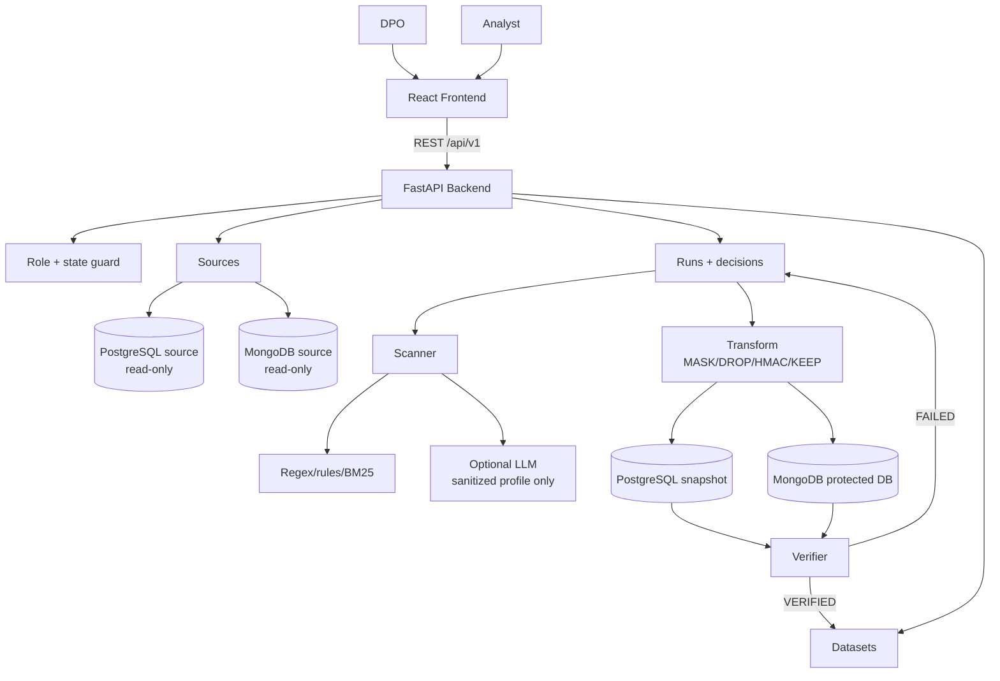
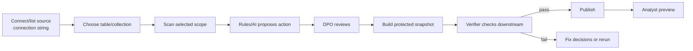
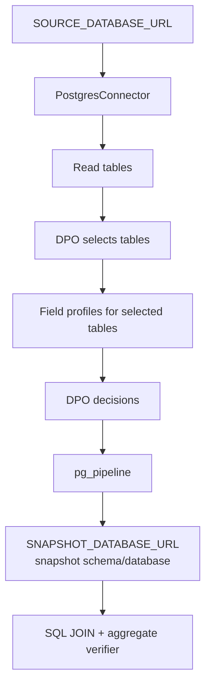
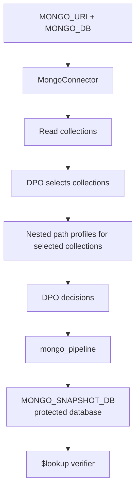
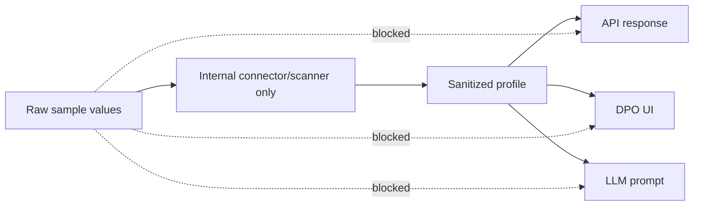

# PIIGuard VN - Architecture Diagram

File này là bản diagram rút gọn để nhìn nhanh. Bản giải thích chi tiết nằm ở [SYSTEM_ARCHITECTURE.md](SYSTEM_ARCHITECTURE.md) và [../ARCHITECTURE.md](../ARCHITECTURE.md).

## Overview



## Main Flow



Input/output của MVP:

```text
Input  = PostgreSQL/MongoDB source database
Output = protected PostgreSQL/MongoDB snapshot database
```

## PostgreSQL Branch



## MongoDB Branch



## Security Boundary



Raw sample có thể dùng nội bộ để regex/rule/BM25 chạy tốt, nhưng không được đưa ra UI, API, log, report hoặc prompt LLM.
