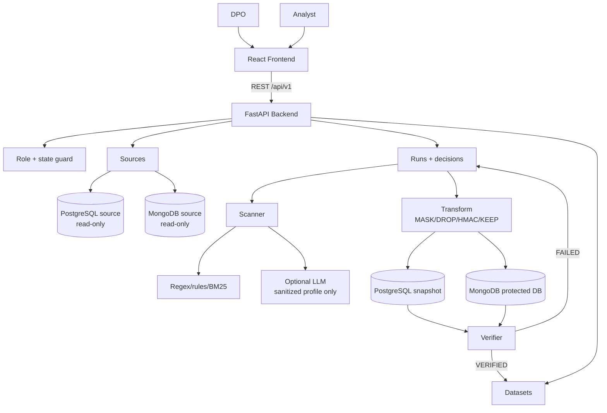
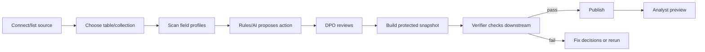
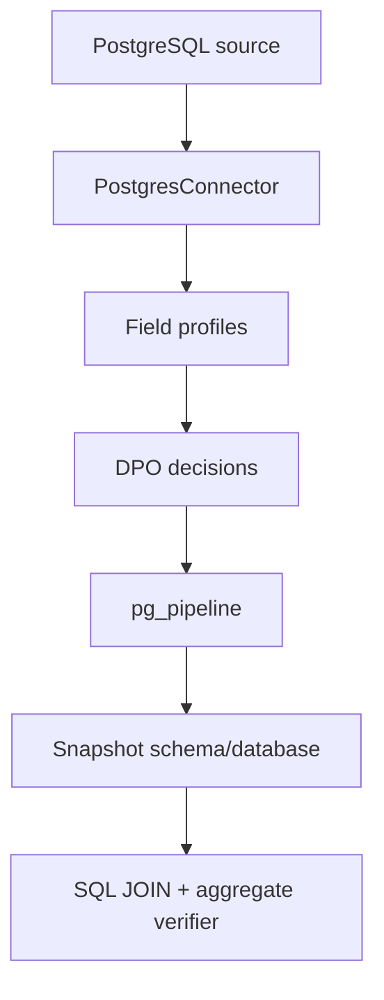
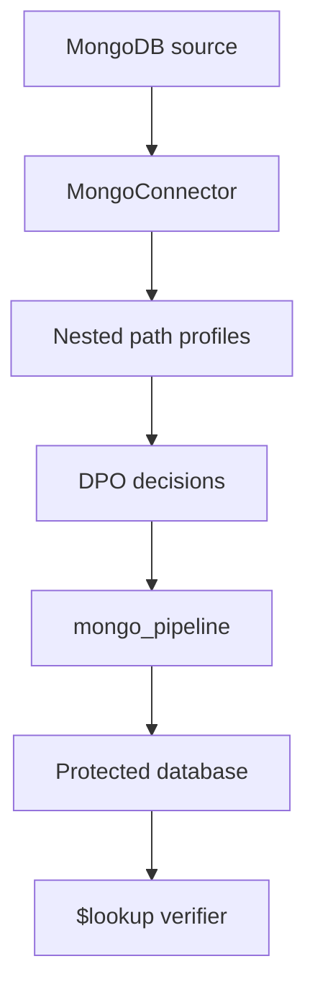
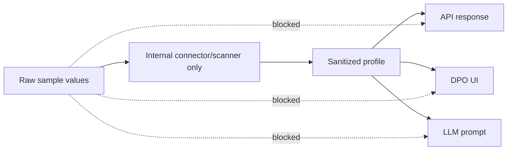

# PIIGuard VN - Architecture Diagram

File nay la ban diagram rut gon de nhin nhanh. Ban giai thich chi tiet nam o [SYSTEM_ARCHITECTURE.md](SYSTEM_ARCHITECTURE.md) va [../ARCHITECTURE.md](../ARCHITECTURE.md).

## Overview

## Main Flow

## PostgreSQL Branch

## MongoDB Branch

## Security Boundary

Raw sample co the dung noi bo de regex/rule/BM25 chay tot, nhung khong duoc dua ra UI, API, log, report hoac prompt LLM.
