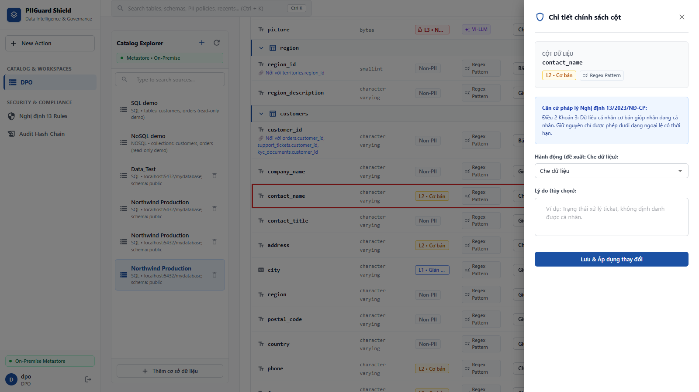
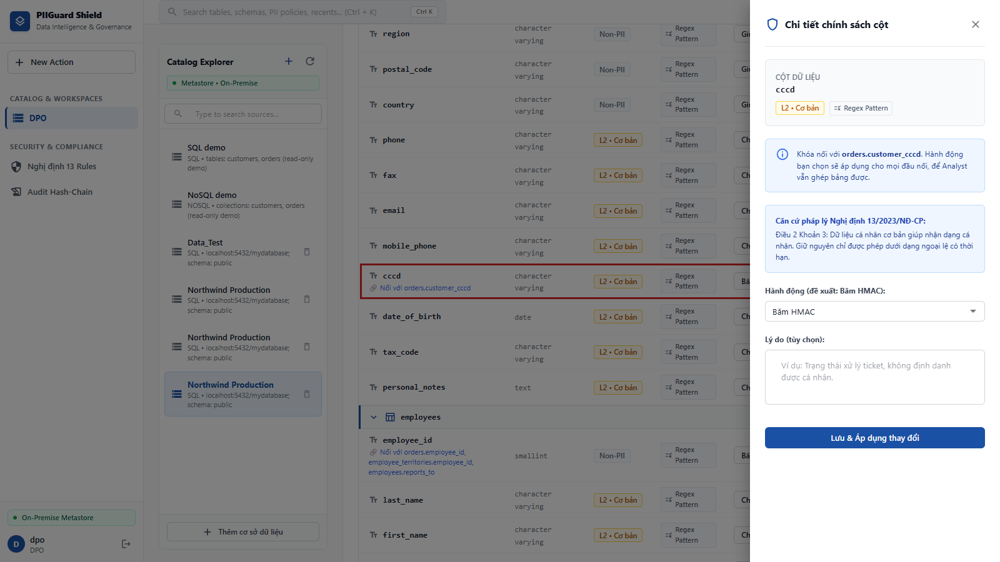
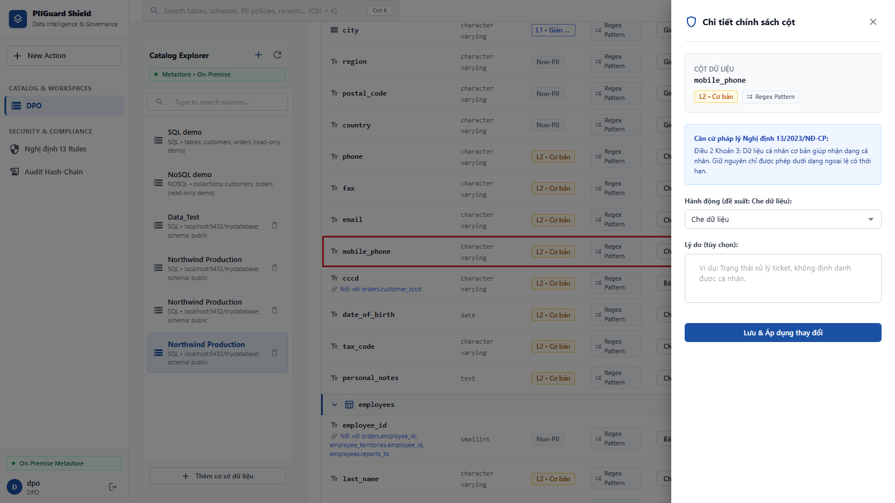
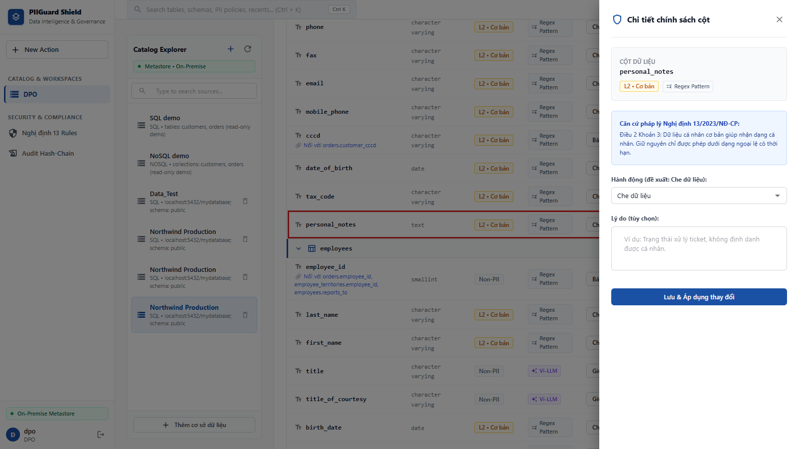
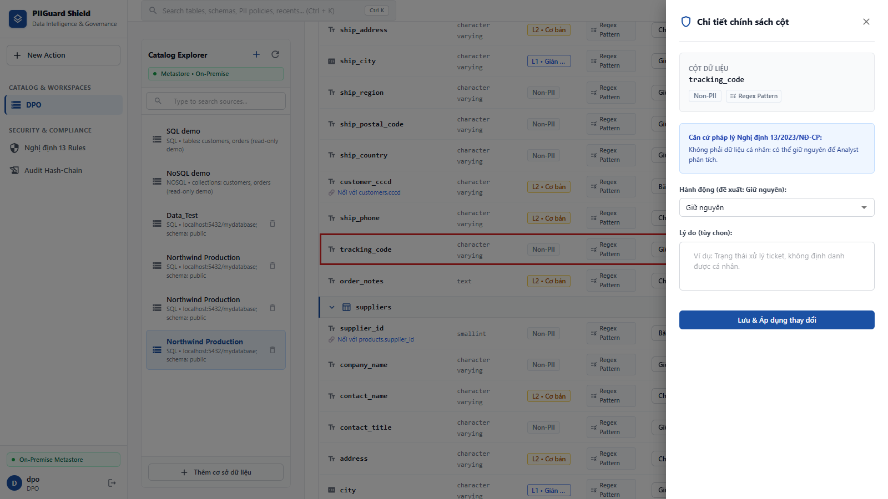

# MVP Gate 2 Submission - PIIGuard VN

Tài liệu này tổng hợp toàn bộ các yêu cầu đầu ra cho **Gate 2 (MVP)** của dự án PIIGuard VN.

---

## 1. Video Demo 3 phút (End-to-End)
- **Link Video:** **https://drive.google.com/drive/folders/1OOIj4LYKQ4vIFTbjH8rg0DRRxJ7hNGoN?usp=sharing**
- **Nội dung:** Video quay lại luồng chạy thực tế từ đầu đến cuối: nhận input (PostgreSQL/MongoDB) → scanner đề xuất policy bằng rules/AI optional → DPO duyệt trên UI → áp dụng policy.

## 2. Architecture Diagram
- Sơ đồ components và luồng dữ liệu (Data Flow) chi tiết nằm tại file: **[ARCHITECTURE.md](../../../ARCHITECTURE.md)**

## 3. Pull Requests (>= 10 PR merged)
- Nhóm đã thực hiện làm việc nhóm và code review nghiêm túc. Hiện tại repo đã có hơn **50 Pull Requests** được merge thành công.

## 4. README.md (Setup & Sample Queries)
- Hướng dẫn cài đặt môi trường, cấu hình biến môi trường (`.env`), cấu trúc thư mục, API endpoints và **Sample Queries (cURL)** nằm tại file gốc của dự án: **[README.md](../../../README.md)**

---

## 5. Eval Evidences - 5 Manual Test Cases với Output Thực Tế

**Cách chạy:** đăng nhập vai trò DPO trên UI, kết nối nguồn PostgreSQL thật (Northwind + PII tổng hợp, `localhost:5432/mydatabase`), bấm **Quét PII**, rồi mở **Chi tiết** từng cột. Có thể chạy rules-only với `ENABLE_AI_SCAN=false`; bật `ENABLE_AI_SCAN=true` để kiểm tra nhánh LLM cho field mập mờ. Kết quả dưới đây là output thực tế của lượt quét **run #37** (04/10/2026). Cột "Mức rủi ro" lấy từ `risk_scorer` (`resolve_sensitivity_level`), cột "Chip UI" là nhãn hiển thị trên màn hình DPO Review. Dữ liệu fixture là tổng hợp 100%, ảnh chụp không chứa giá trị PII.

| # | Bảng.Cột | Kỳ vọng | Output thực tế (loại / phân loại / mức rủi ro / chip UI) | Hành động thực tế | Nguồn nhận diện | Kết quả |
|---|---|---|---|---|---|---|
| 1 | `customers.contact_name` | `FULL_NAME`, L2, MASK | `FULL_NAME` / `PERSONAL_BASIC` / L2 / L2 • Cơ bản | `MASK` | Luật (tên `<thực thể>_name`) | ✅ Đạt |
| 2 | `customers.cccd` | `CCCD`, L3, HMAC | `CCCD` / `PERSONAL_BASIC` / **L3** / **L2 • Cơ bản** | `HMAC` (khóa nối với `orders.customer_cccd`) | Luật (từ khóa) | ✅ Đạt hành động; ⚠️ chip UI hiện L2 |
| 3 | `customers.mobile_phone` | `PHONE`, L2, MASK | `PHONE` / `PERSONAL_BASIC` / L2 / L2 • Cơ bản | `MASK` | Luật (từ khóa) | ✅ Đạt |
| 4 | `customers.personal_notes` | `FREE_TEXT_PII`, L3, MASK | `FREE_TEXT_PII` / `PERSONAL_BASIC` / **L3** / **L2 • Cơ bản** | `MASK` | Luật (regex PII nhúng trong văn bản) | ✅ Đạt hành động; ⚠️ chip UI hiện L2 |
| 5 | `orders.tracking_code` | `TRACKING_NUMBER`, L0, KEEP | `TRACKING_CODE` / `NON_PERSONAL` / L0 / Non-PII | `KEEP` | Luật (ca âm) | ✅ Đạt (tên loại là `TRACKING_CODE`) |

**Tổng kết:** 5/5 ca đúng hành động bảo vệ kỳ vọng. Hai điểm còn lệch, ghi lại để theo dõi:
- Ca 2 và 4: bộ tính rủi ro xếp đúng **L3**, nhưng chip trên UI lấy theo `classification` (`PERSONAL_BASIC`) nên hiện **L2**. Hành động và chặn "Giữ nguyên" không bị ảnh hưởng; cần đồng bộ chip UI với `resolve_sensitivity_level`.
- Ca 5: hệ thống dùng tên loại `TRACKING_CODE` (theo `taxonomy.py`), khác cách gọi `TRACKING_NUMBER` trong kỳ vọng ban đầu.

### Test Case 1: Tên Khách Hàng (Tên Người - Định danh cơ bản)
- **Bảng/Cột:** `customers` / `contact_name`
- **Output thực tế:** `FULL_NAME`, phân loại `PERSONAL_BASIC` (L2 • Cơ bản), nguồn: luật. Lý do hệ thống ghi: "Tên gắn với một người (họ tên)".
- **Hành động đề xuất:** `MASK` (Che dữ liệu)
- **Căn cứ pháp lý:** Luật 91/2025/QH15 Điều 9 Khoản 1
- **Bằng chứng (Screenshot thực tế):**



### Test Case 2: Căn Cước Công Dân (Định danh nhạy cảm cao)
- **Bảng/Cột:** `customers` / `cccd`
- **Output thực tế:** `CCCD`, phân loại `PERSONAL_BASIC`, mức rủi ro L3 (chip UI hiện L2 • Cơ bản), nguồn: luật. Cột được nhận diện là **khóa nối** với `orders.customer_cccd`.
- **Hành động đề xuất:** `HMAC` (Băm HMAC, giữ khả năng JOIN; Che/Loại bỏ bị khóa với khóa nối)
- **Căn cứ pháp lý:** Luật 91/2025/QH15 Điều 9 Khoản 2; NĐ 356/2025/NĐ-CP Điều 4
- **Bằng chứng (Screenshot thực tế):**



### Test Case 3: Số Điện Thoại (PII cơ bản)
- **Bảng/Cột:** `customers` / `mobile_phone`
- **Output thực tế:** `PHONE`, phân loại `PERSONAL_BASIC` (L2 • Cơ bản), nguồn: luật.
- **Hành động đề xuất:** `MASK` (Che dữ liệu). Muốn giữ nguyên phải khai ngoại lệ có lý do và ngày hết hạn.
- **Căn cứ pháp lý:** Luật 91/2025/QH15 Điều 9 Khoản 1
- **Bằng chứng (Screenshot thực tế):**



### Test Case 4: Cột Dữ Liệu Tự Do (Free Text PII / Notes)
- **Bảng/Cột:** `customers` / `personal_notes`
- **Output thực tế:** `FREE_TEXT_PII`, phân loại `PERSONAL_BASIC`, mức rủi ro L3 (chip UI hiện L2 • Cơ bản), nguồn: luật. Lý do hệ thống ghi: "Trường văn bản tự do chứa thông tin PII nhúng (SĐT/CCCD/Email)".
- **Hành động đề xuất:** `MASK` (Che dữ liệu)
- **Căn cứ pháp lý:** Luật 91/2025/QH15 Điều 9 Khoản 1 & 2
- **Bằng chứng (Screenshot thực tế):**



### Test Case 5: Mã Vận Đơn (Không Phải PII - Edge Case)
- **Bảng/Cột:** `orders` / `tracking_code`
- **Output thực tế:** `TRACKING_CODE`, phân loại `NON_PERSONAL` (Non-PII, L0), nguồn: luật. Mã vận đơn 12 chữ số trùng định dạng CCCD nhưng không bị nhận nhầm.
- **Hành động đề xuất:** `KEEP` (Giữ nguyên)
- **Căn cứ pháp lý:** Luật 91/2025/QH15 Điều 2 (Mã logistics nghiệp vụ)
- **Bằng chứng (Screenshot thực tế):**



---

## Phụ lục: Kiến trúc Fallback (Zero-PII Prompting)
Khi TIER_1_RULES không chắc chắn (ambiguous, hoặc ca âm bản cần context như mã số thuế doanh nghiệp), luồng sẽ đi vào nhánh `fp_llm_node`. Prompt LLM đã được làm sạch, hoàn toàn không chứa giá trị raw:
```text
THÔNG TIN TRƯỜNG DỮ LIỆU CẦN PHÂN TÍCH:
- Engine Database: {engine}
- Tên Bảng/Collection: {table}
- Đường dẫn trường (Path): {path}
- Kiểu dữ liệu: {data_type}
- Tổng số dòng Null / Dòng phân biệt (Distinct): {null_count} / {distinct_count}
- Thống kê hình thái học (Shape/Length): {statistics_json}
```
*(LLM nhận diện context table để phân biệt PII cá nhân và mã hệ thống, trả về output chính xác mà KHÔNG làm lộ PII).*
