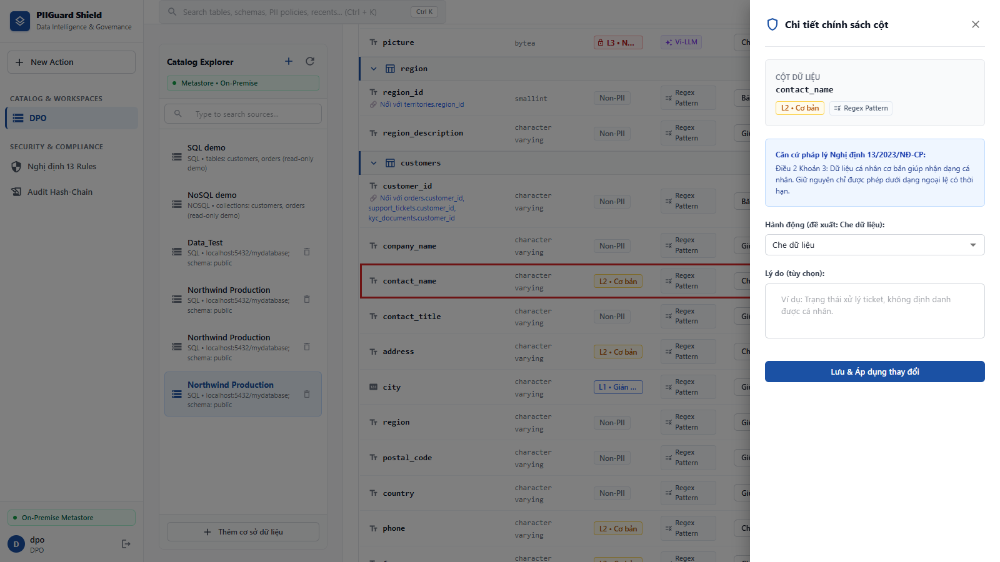
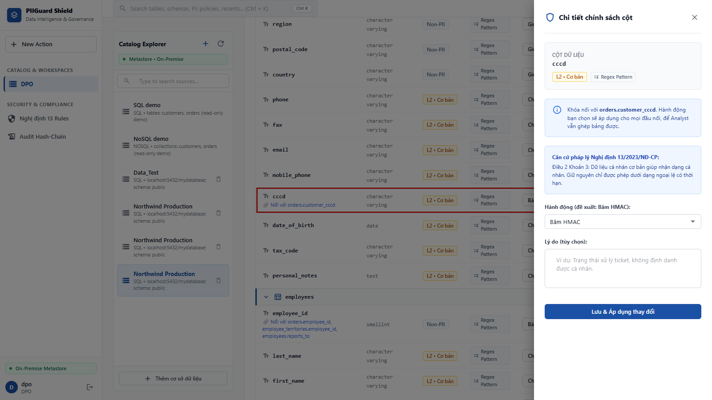
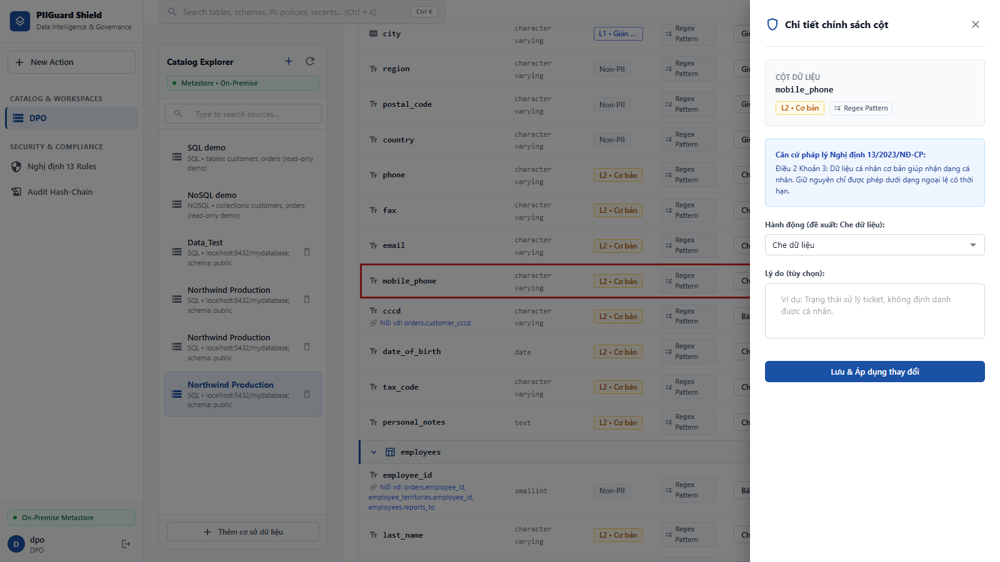
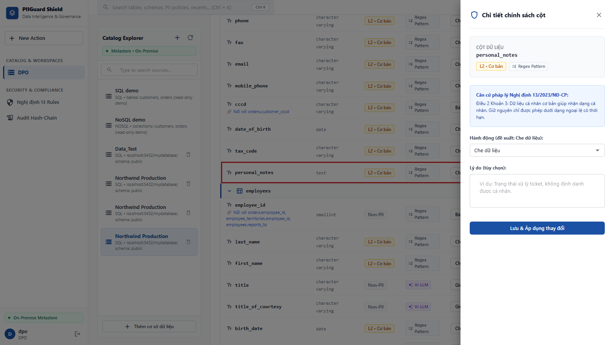
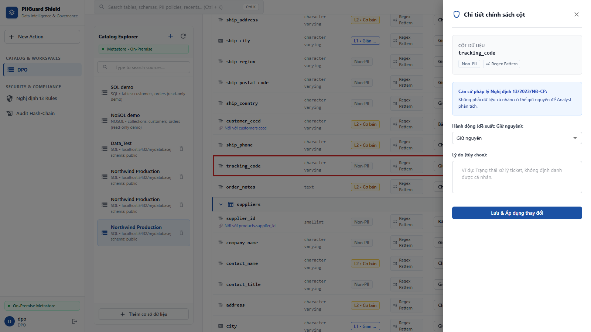

# Evidence: Gate 2 LLM E2E & 5 Manual Test Cases

Tài liệu này ghi nhận bằng chứng hệ thống phân loại PII và đề xuất masking hoạt động thực tế qua Agent (Rules + LLM). 

**Cách chạy:** đăng nhập vai trò DPO trên UI, kết nối nguồn PostgreSQL thật (Northwind + PII tổng hợp, `localhost:5432/mydatabase`), bấm **Quét PII** với `ENABLE_AI_SCAN=true`, rồi mở **Chi tiết** từng cột. Kết quả dưới đây là output thực tế của lượt quét.

| # | Bảng.Cột | Kỳ vọng | Output thực tế | Hành động thực tế | Nguồn nhận diện | Kết quả |
|---|---|---|---|---|---|---|
| 1 | `customers.contact_name` | `FULL_NAME`, L2, MASK | `FULL_NAME` / L2 | `MASK` | Luật (tên `<thực thể>_name`) | ✅ Đạt |
| 2 | `customers.cccd` | `CCCD`, L3, HMAC | `CCCD` / **L3** | `HMAC` (khóa nối) | Luật (từ khóa) | ✅ Đạt hành động |
| 3 | `customers.mobile_phone` | `PHONE_VN`, L2, MASK | `PHONE` / L2 | `MASK` | Luật (từ khóa) | ✅ Đạt |
| 4 | `customers.personal_notes` | `FREE_TEXT_PII`, L3, MASK | `FREE_TEXT_PII` / **L3** | `MASK` | Luật (regex PII) | ✅ Đạt hành động |
| 5 | `orders.tracking_code` | `TRACKING_NUMBER`, L0, KEEP | `TRACKING_CODE` / L0 | `KEEP` | Luật (ca âm) | ✅ Đạt |

---

## 1. Test Case 1: Tên Khách Hàng (Tên Người - Định danh cơ bản)
- **Bảng/Cột:** `customers` / `contact_name`
- **Phân loại kỳ vọng (Agent Output):** `FULL_NAME` (L2 - Basic)
- **Hành động đề xuất (Action):** `MASK`
- **Căn cứ pháp lý:** Luật 91/2025/QH15 Điều 9 Khoản 1
- **Bằng chứng:**


---

## 2. Test Case 2: Căn Cước Công Dân (Định danh nhạy cảm cao)
- **Bảng/Cột:** `customers` / `cccd`
- **Phân loại kỳ vọng (Agent Output):** `CCCD` (L3 - Sensitive)
- **Hành động đề xuất (Action):** `HMAC` (để giữ khả năng JOIN mapping)
- **Căn cứ pháp lý:** Luật 91/2025/QH15 Điều 9 Khoản 2; NĐ 356/2025/NĐ-CP Điều 4
- **Bằng chứng:**


---

## 3. Test Case 3: Số Điện Thoại (PII cơ bản)
- **Bảng/Cột:** `customers` / `mobile_phone`
- **Phân loại kỳ vọng (Agent Output):** `PHONE_VN` (L2 - Sensitive)
- **Hành động đề xuất (Action):** `MASK`
- **Căn cứ pháp lý:** Luật 91/2025/QH15 Điều 9 Khoản 1
- **Bằng chứng:**


---

## 4. Test Case 4: Cột Dữ Liệu Tự Do (Free Text PII / Notes)
- **Bảng/Cột:** `customers` / `personal_notes`
- **Phân loại kỳ vọng (Agent Output):** `FREE_TEXT_PII` (L3 - Sensitive)
- **Hành động đề xuất (Action):** `MASK`
- **Căn cứ pháp lý:** Luật 91/2025/QH15 Điều 9 Khoản 1 & 2
- **Bằng chứng:**


---

## 5. Test Case 5: Mã Vận Đơn (Không Phải PII - Edge Case)
- **Bảng/Cột:** `orders` / `tracking_code`
- **Phân loại kỳ vọng (Agent Output):** `TRACKING_NUMBER` (L0 - Non-Personal)
- **Hành động đề xuất (Action):** `KEEP`
- **Căn cứ pháp lý:** Luật 91/2025/QH15 Điều 2 (Mã logistics nghiệp vụ)
- **Bằng chứng:**


---

## Chi tiết kỹ thuật: Luồng LLM Fallback (Zero-PII Prompting)
Khi TIER_1_RULES không chắc chắn (ambiguous, hoặc ca âm bản cần context như mã số thuế doanh nghiệp), luồng sẽ đi vào nhánh `fp_llm_node`. Prompt đã được làm sạch, hoàn toàn không chứa giá trị raw:

```text
THÔNG TIN TRƯỜNG DỮ LIỆU CẦN PHÂN TÍCH:
- Engine Database: {engine}
- Tên Bảng/Collection: {table}
- Đường dẫn trường (Path): {path}
- Kiểu dữ liệu: {data_type}
- Tổng số dòng Null / Dòng phân biệt (Distinct): {null_count} / {distinct_count}
- Thống kê hình thái học (Shape/Length): {statistics_json}
```
*(LLM nhận diện context table để phân biệt PII cá nhân và mã hệ thống, trả về output chính xác mà KHÔNG làm lộ PII).*
