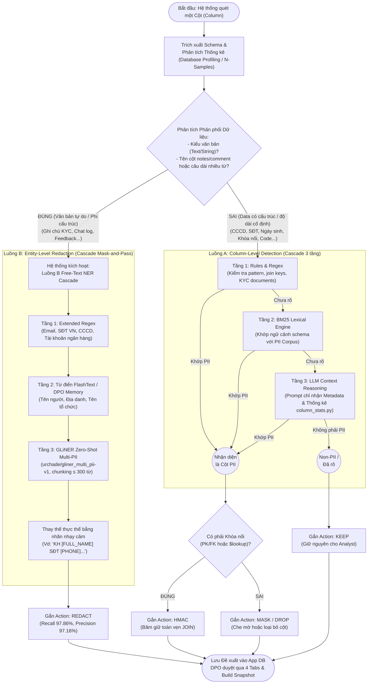

# PIIGuard Shield - Sơ đồ Luồng Phân loại & Redact PII

Sơ đồ thể hiện luồng xử lý nhận diện và làm mờ dữ liệu cá nhân (PII), bao gồm sự phân chia giữa luồng dữ liệu cấu trúc (Column-level - Luồng A) và phi cấu trúc (Entity-level - Luồng B) dựa trên việc phân tích tính chất phân phối dữ liệu (Variance) và kiểu dữ liệu.

