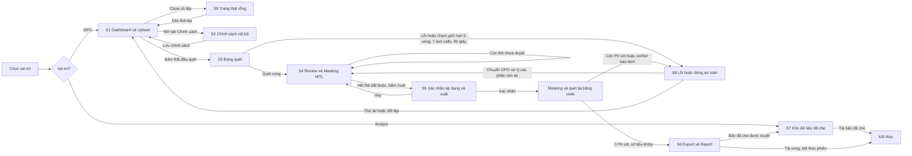

# UI Flow & Wireframe — PIIGuard VN

> Mã đề DATA-06 · Đội P-XXX · Cập nhật: dd/mm/yyyy

Sản phẩm có 2 vai trò: **DPO / Data team** (tải tệp, duyệt, xuất) và **Analyst** (chỉ xem bản đã che). Có 9 màn hình, gồm màn chính của từng vai trò, màn xác nhận cho hành động rủi ro và ba trạng thái (đang xử lý, lỗi, rỗng).

## Danh sách màn hình

| # | Màn hình | Vai trò | Vì sao cần | Wireframe |
|---|---|---|---|---|
| S1 | Dashboard & Upload (tab Quét nhiều tệp) | DPO | Điểm bắt đầu, kéo thả nhiều tệp | Đã có (Màn hình 1) |
| S2 | Chính sách nội bộ | DPO | Xem và chỉnh bảng chính sách masking | Cần vẽ riêng |
| S3 | Đang quét (AI Processing) | DPO | Trạng thái đang xử lý, agent chạy nhiều bước | Đã có (Màn hình 2) |
| S4 | Review & Masking (HITL) | DPO | Màn chính của vai trò 1 | Đã có (Màn hình 3) |
| S5 | Xác nhận áp dụng masking và xuất | DPO | Màn xác nhận cho hành động rủi ro | Cần vẽ |
| S6 | Export & Report | DPO | Tải bản đã che, báo cáo, nhật ký | Đã có (Màn hình 4) |
| S7 | Kho dữ liệu đã che | Analyst | Màn chính của vai trò 2 | Cần vẽ |
| S8 | Lỗi / dừng an toàn | DPO | Trạng thái lỗi, không trả lời được | Cần vẽ |
| S9 | Trạng thái rỗng | DPO | Màn đầu tiên khi chưa có tệp | Cần vẽ |

## UI Flow

## Chi tiết từng màn hình

### S1 · Dashboard & Upload (DPO)
- **Mục đích:** điểm bắt đầu, tối giản, tập trung vào hành động tải dữ liệu.
- **Thành phần:** 2 tab (Quét nhiều tệp, Chính sách nội bộ); vùng kéo thả nhiều CSV/XLSX; danh sách tệp đã đánh số #1, #2, …; nút Bắt đầu quét.
- **Hành động:** kéo thả tệp → thấy danh sách tệp; bấm Bắt đầu quét → S3; mở tab Chính sách → S2; chưa có tệp → S9.

### S2 · Chính sách nội bộ (DPO)
- **Mục đích:** DPO xem và chỉnh bảng chính sách masking.
- **Thành phần:** bảng loại PII × vai trò → giữ/che/băm/tokenize; nút Lưu; hiển thị chính sách trước và sau khi sửa.
- **Hành động:** Lưu → xác nhận thay đổi, ghi vào nhật ký kiểm toán, quay lại S1.

### S3 · Đang quét (DPO)
- **Mục đích:** cho biết hệ thống đang ở giai đoạn nào, tránh cảm giác app bị treo.
- **Thành phần:** tiến độ theo từng bước (lập hồ sơ cột, quét theo luật, chấm điểm tin cậy, LLM xử lý cột mơ hồ, đối chiếu chính sách) và theo từng tệp; nhắc nguyên tắc an toàn (quyết định do bộ luật thực thi, LLM không nhận dữ liệu gốc, agent tự dừng khi chạm giới hạn).
- **Chuyển màn:** quét xong → S4; lỗi hoặc chạm giới hạn → S8.

### S4 · Review & Masking, HITL (DPO)
- **Mục đích:** màn hình quan trọng nhất; DPO tương tác với kết quả của AI.
- **Thành phần:** chia đôi. Trái: bảng xem trước tô màu (đỏ: tin cậy cao, vàng: cần xem) và dải số thứ tự tệp có cảnh báo. Phải: các thẻ PII kèm loại, độ tin cậy, luật khớp và hành động che đề xuất. Cột không tên (col_7) vẫn được phát hiện; mẫu chỉ giống PII (mã đơn 12 chữ số) được đề xuất loại trừ.
- **Hành động:** Chấp nhận / Từ chối / Sửa từng thẻ; bấm số thứ tự tệp để đổi tệp; hết thẻ bắt buộc → nút Xuất → S5.

### S5 · Xác nhận áp dụng masking và xuất (DPO)
- **Mục đích:** chặn hành động rủi ro (tạo dữ liệu chia sẻ ra ngoài) bằng một bước xác nhận có thông tin.
- **Thành phần:** hộp thoại tóm tắt: số thẻ đã chấp nhận, từ chối, sửa; hành động che theo từng loại PII; số thẻ chưa duyệt (phải bằng 0); nhắc rằng dữ liệu gốc không bị sửa.
- **Hành động:** Xác nhận → masking và quét lại bằng code → S6; Hủy → quay lại S4.

### S6 · Export & Report (DPO)
- **Mục đích:** hoàn tất phiên làm việc.
- **Thành phần:** kết quả quét lại (0 PII định dạng cứng còn sót); nút tải bản dữ liệu đã che (CSV/XLSX), báo cáo tuân thủ (PDF), nhật ký kiểm toán; thông báo bản đã che sẽ xuất hiện trong Kho dữ liệu đã che cho Analyst.
- **Hành động:** tải các tệp; kết thúc phiên (không lưu nguyên văn dữ liệu tải lên).

### S7 · Kho dữ liệu đã che (Analyst)
- **Mục đích:** màn chính của vai trò 2; Analyst chỉ làm việc với bản đã che.
- **Thành phần:** danh sách bản đã che đã được DPO duyệt; xem trước bảng đã che; nút tải; ghi chú token nhất quán để join giữa các bảng.
- **Hạn chế:** không có đường tới dữ liệu gốc, không có thẻ PII, không có chỉnh chính sách.

### S8 · Lỗi / dừng an toàn (DPO)
- **Mục đích:** trạng thái lỗi và không trả lời được; nói thẳng giới hạn với người dùng.
- **Các biến thể nội dung:**
  - Agent chạm giới hạn 5 vòng suy luận, 7 tool calls hoặc timeout 90 giây: nêu tệp/cột chưa xử lý xong, chuyển DPO xử lý các phần còn lại.
  - LLM lỗi hoặc hết quota: nêu phần nào chưa được phân tích (cột mơ hồ, văn bản tự do, diễn giải báo cáo); phần chạy bằng code vẫn dùng được.
  - Tệp sai định dạng hoặc quá lớn: nêu tên tệp và cách xử lý.
  - Quét lại còn PII sót hoặc verifier báo số liệu lệch: chặn xuất, liệt kê ô còn sót hoặc số liệu bị lệch.
- **Hành động:** chuyển DPO xử lý (→ S4), thử lại hoặc đổi tệp (→ S1).

### S9 · Trạng thái rỗng (DPO)
- **Mục đích:** màn đầu tiên người dùng thấy khi chưa có tệp nào.
- **Thành phần:** vùng kéo thả nổi bật; câu giải thích ngắn (hệ thống làm gì, chỉ nhận CSV/XLSX, dữ liệu gốc không được lưu sau phiên); nút chọn tệp.
- **Hành động:** kéo thả tệp → S1.
