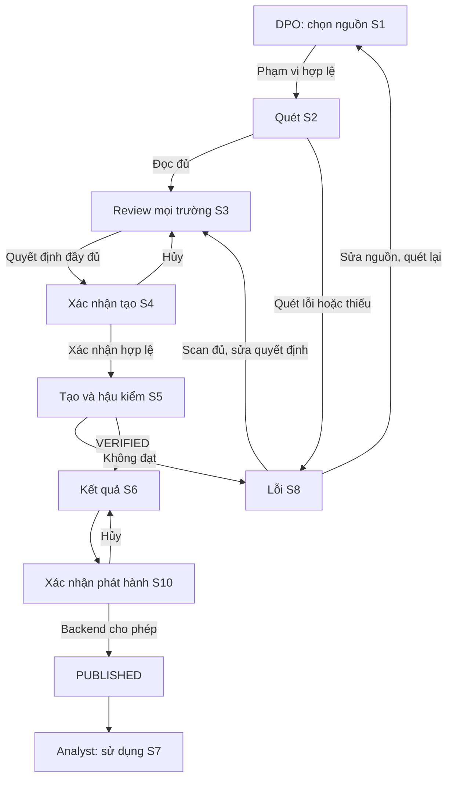

# UI Flow & Wireframe — PIIGuard VN

**Mã đề:** DATA-06 · **Đội:** P-138 · **Cập nhật:** 21/09/2026  
**Phạm vi:** MVP 14 ngày; PostgreSQL và MongoDB đều P0; dữ liệu mô phỏng.

Có hai tài khoản demo **DPO** và **Analyst**, vai trò xác thực tại server. DPO có quy trình quét–duyệt–phát hành; Analyst chỉ dùng snapshot đã phát hành. Mười trạng thái dưới đây được gộp vào **5 trang và 2 modal**, không cần xây mười trang riêng.

## 1. Màn hình và trạng thái

| ID | Màn hình/trạng thái | Vai trò | Cách dựng |
|---|---|---|---|
| S1 | Nguồn dữ liệu | DPO | Trang; chọn PostgreSQL hoặc MongoDB đã cấu hình |
| S2 | Đang quét | DPO | Trạng thái trang xử lý |
| S3 | Review trường và chính sách | DPO | Trang; danh sách và panel chi tiết |
| S4 | Xác nhận tạo dataset | DPO | Modal trên S3 |
| S5 | Đang tạo và hậu kiểm | DPO | Trang xử lý, khác giai đoạn S2 |
| S6 | Kết quả, cảnh báo và báo cáo | DPO | Trang; có xác nhận phát hành/thu hồi |
| S7 | Kho dữ liệu phân tích | Analyst | Trang; danh sách, preview đã xử lý và tác vụ mẫu |
| S8 | Lỗi / không trả lời được | Theo trang | Trạng thái lỗi tại bước liên quan |
| S9 | Chưa có dữ liệu | DPO/Analyst | Empty state trên S1/S7 |
| S10 | Xác nhận phát hành | DPO | Modal trên S6 |

## 2. UI Flow

Hai nhánh lỗi có điều kiện: lỗi nguồn/scan bắt buộc quay S1; lỗi LLM riêng lẻ có kết quả scan đầy đủ được quay S3 để duyệt thủ công; lỗi build/policy được sửa ở S3 rồi tạo lại. Không có đường từ lỗi đến phát hành mà bỏ qua xác nhận và verifier.

S9 của DPO dẫn về chọn nguồn S1; S9 của Analyst chỉ có “Làm mới”. Analyst không đi vào luồng DPO. Khi DPO thu hồi tại S6, backend chuyển REVOKED; bản đó ngừng xuất hiện hoặc hiện “Đã thu hồi” không kèm dữ liệu tại S7.

## 3. Bố cục và hành vi từng màn hình

### S1 — Nguồn dữ liệu, trang chính DPO

| Vùng | Nội dung |
|---|---|
| Đầu trang | PIIGuard VN; tài khoản DPO; nhãn “Dữ liệu mô phỏng” |
| Nguồn | Hai lựa chọn PostgreSQL/MongoDB; tên nguồn demo, trạng thái kết nối |
| Phạm vi | Cặp customers/orders; số bảng/collection, số trường/bản ghi; kiểu dữ liệu chưa hỗ trợ |
| Tác vụ | Tên phép SQL join hoặc MongoDB lookup sẽ được kiểm tra |
| Chân trang | Kiểm tra kết nối; Bắt đầu quét |

Không nhập chuỗi kết nối trên trình duyệt trong P0. Nút quét chỉ bật sau khi xác minh nguồn chỉ đọc, đúng fixture và không vượt giới hạn. Mỗi run chọn một nguồn; không giả vờ hai nguồn được join với nhau.

### S2 — Đang quét

Hiện các bước thực: đọc schema → đọc phạm vi → chạy quy tắc → AI hỗ trợ → chờ DPO. Hiện số trường đã đọc nếu backend có; không dùng phần trăm giả. Không hiện mẫu dữ liệu gốc.

LLM hết quota/timeout/JSON sai: thông báo “AI chưa đưa ra đề xuất; các mục này cần bạn duyệt”. Nếu scan hoàn tất, vẫn vào S3; nếu scan thiếu, vào S8 và chặn build. Ghi rõ nguồn, run và thời điểm bắt đầu để người dùng biết đang xử lý phiên nào.

### S3 — Review trường và chính sách, trang chính DPO

Bảng trái liệt kê **mọi trường**, gồm cả UNKNOWN và trường do hệ thống sinh. Các cột: đường dẫn; kiểu; phân loại; độ phủ detector; action; trạng thái duyệt. Bộ lọc nhanh: chưa duyệt, chưa rõ, bị loại, có ảnh hưởng liên kết.

Panel phải hiển thị:

- Tên loại pháp lý nếu đã ánh xạ; văn bản, điều/khoản và link nguồn từ danh mục đã duyệt.
- Nguồn đề xuất: rule, AI hoặc DPO; lý do ngắn; giới hạn nhận diện. Không hiện “độ tin cậy 98%” nếu chưa hiệu chuẩn.
- Action bằng ngôn ngữ người dùng: **Bỏ trường**, **Che toàn bộ**, **Tạo mã liên kết**, **Giữ trường đã được duyệt**.
- Ảnh hưởng: giữ/mất khóa cần cho tác vụ, thiếu trường phân tích, hoặc cần xem lại tổ hợp trường.
- Nút **Chấp nhận**, **Sửa**, **Bác đề xuất**; lý do bắt buộc khi sửa/bác hoặc xác nhận không phải dữ liệu cá nhân.

“Tạo mã liên kết” dùng HMAC theo PRD; không cho user chọn thuật toán hay nhập khóa bí mật. Bác đề xuất không tự động giữ dữ liệu. Với UNKNOWN, DPO có thể chọn loại có căn cứ hoặc **Bỏ trường chưa xác định**; không cho chọn KEEP để bỏ qua cảnh báo.

Cảnh báo tách riêng: lỗi chặn, phân loại pháp lý, độ chắc chắn phát hiện. Không có thang điểm pháp lý do AI tự tạo. Với loại chưa triển khai, hiện “Chưa có bằng chứng nhận diện tự động” thay vì “Không có PII”.

Cuối trang có tổng số trường, đã quyết định, chưa quyết định và UNKNOWN đã chọn DROP. Nút tạo chỉ bật khi mọi trường có quyết định hợp lệ; backend kiểm tra lại. Không hiện giá trị nguyên bản trong preview, tooltip hay payload lỗi.

### S4 — Xác nhận tạo dataset

Modal liệt kê nguồn và phiên dữ liệu, nơi ghi đích, số trường MASK/DROP/HMAC/KEEP, danh sách UNKNOWN sẽ bị loại, tên khóa liên kết và tác vụ cần đạt.

Nội dung xác nhận: “Tạo bản dữ liệu theo các quyết định đã duyệt. Bản này chỉ được chia sẻ sau khi kiểm tra đạt và bạn xác nhận phát hành.”

**Hủy** quay S3. **Xác nhận tạo** gọi backend; khóa nút lúc gửi để tránh lặp. Nếu nguồn/decision version đã đổi, báo S8 và yêu cầu xử lý lại, không tự dùng quyết định cũ.

### S5 — Đang tạo và hậu kiểm

Các bước: áp dụng policy → ghi bản staging → kiểm tra đầu ra → chạy downstream → đối chiếu báo cáo. Hiện trạng thái từng bước. Analyst không đọc được staging, kể cả biết dataset ID.

Hoàn tất chỉ dẫn đến S6 khi VERIFIED. Lỗi dẫn S8; không có nút “Bỏ qua và phát hành”. Thử lại không ghi đè một bản đã công bố.

### S6 — Kết quả và báo cáo

Hiển thị nguồn, thời điểm snapshot, phiên policy, phạm vi đã quét, actions, kết quả verifier và downstream. Báo cáo có cả trường UNKNOWN đã bị loại; không báo chúng là đã phân loại thành công.

Kết quả downstream chỉ gồm các số so sánh và sai khác cần thiết; không đưa định danh nguồn vào báo cáo. Nhãn chuẩn: **“Đạt các kiểm tra đã khai báo trên fixture này”**. Tránh nhãn “Đã tuân thủ luật” hoặc “Đã sạch toàn bộ PII”.

Các hành động: tải JSON không chứa giá trị nguồn; xem audit; tạo phiên mới; **Phát hành** nếu VERIFIED. Bản PUBLISHED có **Thu hồi**, xác nhận hậu quả trước khi thực hiện. Báo cáo PDF của sản phẩm không nằm trong MVP.

### S10 — Xác nhận phát hành

Hiện dataset/version, vai trò được đọc, tác vụ được phép, kết quả kiểm tra và giới hạn. Nút **Phát hành cho Analyst** chỉ gửi lệnh sau xác nhận; backend kiểm tra quyền, trạng thái, phiên policy và manifest đầu ra một lần nữa. Lỗi cập nhật quyền/trạng thái không được hiển thị “Đã phát hành”.

### S7 — Kho dữ liệu phân tích, trang chính Analyst

Hiển thị các snapshot PUBLISHED, loại nguồn, thời điểm, tác vụ đã được kiểm tra và trường đã loại. Preview chỉ lấy từ đầu ra đã xử lý, qua API được kiểm tra quyền. Analyst bấm **Chạy tác vụ mẫu** và xem kết quả tổng hợp; không có SQL editor, download nguồn hay form sửa policy.

Dữ liệu snapshot không tự cập nhật khi nguồn thay đổi. Hiện rõ thời điểm bản dữ liệu để Analyst không nhầm với dữ liệu trực tiếp. Bản bị thu hồi phải ngừng đọc ngay ở API; dữ liệu đã hiển thị trước đó không thể được hệ thống đảm bảo “thu hồi khỏi trí nhớ/bản sao”.

### S8 — Lỗi / giới hạn

Hiển thị bước lỗi, phần đã xong, việc cần sửa và trạng thái chặn. Không hiện stack trace, secret hay dữ liệu gốc. Ví dụ:

| Lỗi | Thông báo/hành động |
|---|---|
| Không đọc đủ nguồn | “Chưa quét đủ dữ liệu; kiểm tra quyền hoặc phạm vi rồi quét lại.” |
| Trường chưa hỗ trợ | “Trường này chưa được xử lý; duyệt loại khỏi đầu ra hoặc sửa phạm vi.” |
| Khóa liên kết sai | “Không thể tạo mã liên kết nhất quán; kiểm tra kiểu và cấu hình.” |
| Phép phân tích sai khác | “Kết quả chưa khớp; quay lại chính sách để sửa.” |
| Trái quyền | “Tài khoản này không có quyền thực hiện.” |

### S9 — Trạng thái rỗng

| Trường hợp | Nội dung | Hành động |
|---|---|---|
| DPO chưa chọn nguồn | Chọn một trong hai database demo để bắt đầu | Chọn nguồn → S1 |
| Nguồn không có bản ghi | Không có dữ liệu để đánh giá | Kiểm tra fixture; không phát hành |
| Analyst chưa có bản công bố | Chưa có dataset được DPO phát hành | Làm mới S7 |

## 4. Quy tắc nghiệm thu UI

- Hai tài khoản không truy cập chéo quyền khi gọi trực tiếp API.
- Đủ loading, lỗi, empty, review, hai xác nhận và kết quả cho cả PostgreSQL/MongoDB.
- Quy trình có thể hoàn thành với trường chưa rõ được DROP; báo cáo vẫn ghi chưa phân loại.
- Trường mới/nhánh object chưa duyệt không xuất hiện nguyên vẹn trong đầu ra.
- Nút bấm và URL không thể vượt qua trạng thái backend trong [PRD](prd.md).
- Nội dung UI dùng ngôn ngữ nghiệp vụ; thuật toán, credential và cấu hình hạ tầng không biến thành bước bắt buộc đối với Analyst.
