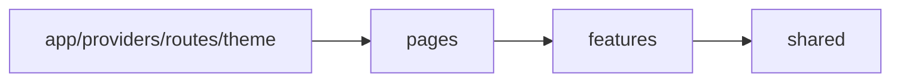

# ADR 0001: Frontend Architecture Style

Use feature-sliced React architecture.



Dependency direction is one-way:

```text
app -> pages -> features -> shared
```

Rules:

- Pages only compose screens.
- Features own domain UI, hooks, API, and model code.
- Shared code must be generic and reusable.
- Components do not call backend APIs directly.
- API responses are validated at the feature boundary.
