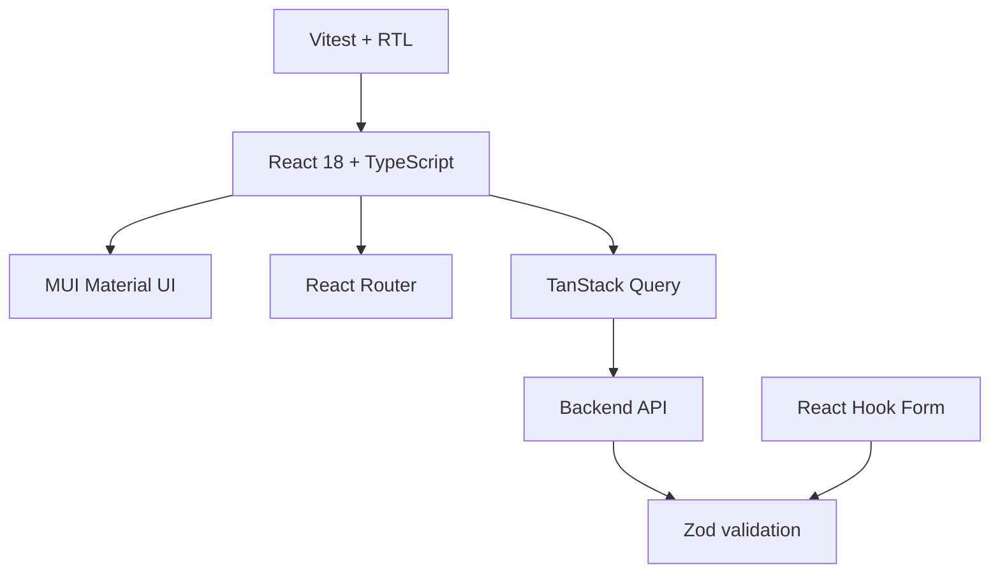

# ADR 0002: Tech Stack

Use the stack required by `front_end/AGENTS.md`.

Frontend baseline:

- Build tool: Vite
- UI: MUI + Roboto via `@fontsource`
- Server state: TanStack Query
- Validation: Zod
- Forms: React Hook Form
- Tests: Vitest + React Testing Library
