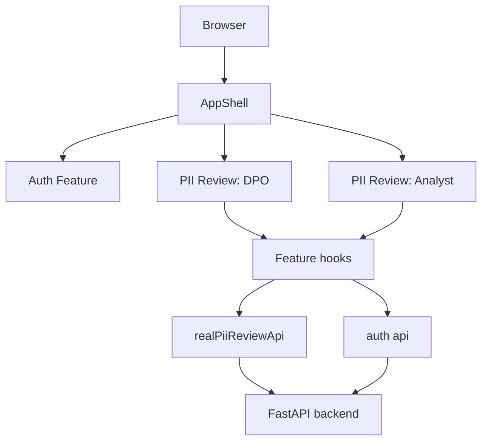

# ADR 0003: Folder Structure

```text
src/
  app/                  # providers, routes, theme
  pages/                # route-level composition
  features/
    auth/               # login/session role flow
    piiReview/          # DPO + Analyst dataset workflow
  shared/
    config/             # app routes/config
    ui/                 # reusable UI components
```

Feature shape:

```text
features/<feature>/
  api/                  # HTTP calls, DTO validation
  model/                # pure types/rules
  hooks/                # TanStack Query orchestration
  components/           # MUI UI
  index.ts              # public exports
```

Runtime architecture:



Raw PII must not be rendered in any route.
