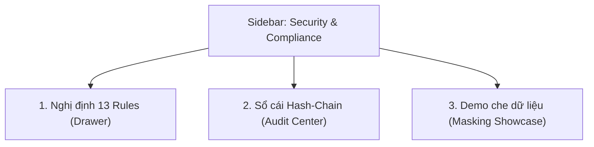
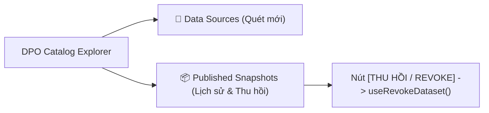

# ADR 0004: Sidebar Governance Hub & Dataset Revocation Architecture

## Bối cảnh (Context)
Trong giai đoạn mở rộng tính năng bảo vệ dữ liệu cá nhân (PIIGuard Shield) theo Luật BV DLCN 2025 và Nghị định 13/2023/NĐ-CP:
1. DPO cần truy cập nhanh cẩm nang quy tắc pháp lý và trung tâm kiểm toán Sổ cái mật mã Merkle Root SHA-256 mọi lúc mọi nơi.
2. Cả DPO và Analyst cần hình dung trực quan cách thức dữ liệu bị biến đổi (Format-Preserving Masking, HMAC Salted Hash, DROP, KEEP) thông qua một màn hình Demo độc lập, thay vì đặt trong một tab nhỏ của Analyst.
3. Cần giải quyết bài toán quản trị vòng đời cho các dataset đã phát hành: DPO cần xem lịch sử các snapshot và có quyền Thu hồi (Revoke) ngay lập tức khi phát hiện rủi ro hoặc khi hết hạn ngoại lệ (`exceptionUntil`).

## Quyết định Kiến trúc (Architectural Decisions)

### 1. Phân Hệ Độc Lập Trên Sidebar (`AppShell.tsx`)
Mục **Security & Compliance** trên Sidebar được cấu trúc thành 3 công cụ độc lập:
1. **Nghị định 13 Rules**: Mở Drawer/Modal tra cứu danh mục dữ liệu Cơ bản (L2), Nhạy cảm (L3), Gián tiếp (L1), sàn bảo mật tối thiểu và các điều khoản pháp lý trọng yếu (Điều 9, 10, 11, 17, 24).
2. **Sổ cái Hash-Chain**: Mở Trung tâm kiểm toán mật mã toàn hệ thống, hiển thị chuỗi khối Merkle Root SHA-256, chữ ký số DPO, và công cụ kiểm chứng toàn vẹn (Verify Integrity).
3. **Demo che dữ liệu (Masking Showcase)**: Nằm **ngay DƯỚI "Sổ cái Hash-Chain"**, cung cấp giao diện so sánh trực quan đa chiều (Side-by-side: Raw vs MASK vs HMAC vs DROP vs KEEP) theo từng loại dữ liệu PII.

### 2. DPO Catalog Explorer: Phân Vùng 2 Nhánh (Phương Án 1)
Cột Catalog bên trái của DPO Workspace được chia thành 2 phân hệ rõ ràng:
- 📂 **Data Sources**: Quản lý kết nối cơ sở dữ liệu gốc (PostgreSQL, MongoDB), hỗ trợ thêm mới và kích hoạt phiên quét PII.
- 📦 **Published Snapshots**: Danh sách toàn bộ các snapshot đã phát hành kèm nhãn trạng thái `PUBLISHED` hoặc `REVOKED`. DPO có thể chọn snapshot để xem thông tin kiểm toán và thực thi **[THU HỒI / REVOKE]**.

### 3. Nguyên Tắc Bất Biến & Xử Lý Hết Hạn Ngoại Lệ
- Snapshot đã xuất bản là **Bất biến (Immutable)** để bảo toàn chứng chỉ Merkle Root SHA-256.
- Khi một trường PII hết hạn ngoại lệ (`now > exceptionUntil`):
  - **Không sửa đè (Update in-place)** để tránh phá vỡ Merkle Tree.
  - **Không xóa sổ (Hard Delete)** để bảo toàn lịch sử kiểm toán.
  - **Quy trình chuẩn**: DPO bấm **REVOKE** bản snapshot cũ (Analyst lập tức mất quyền truy cập) ➔ Thực hiện **RE-BUILD & PUBLISH** bản mới (Snapshot v2 đã che mờ).

### 4. Tinh Giản Tabs DPO Workspace
Loại bỏ các tab mockup tĩnh (Permissions & Grants) và tab xem dữ liệu con, giữ lại 3 tab nghiệp vụ cốt lõi:
- **Tab 0 — Overview & PII Schema**: Khảo sát schema, sàn bảo mật, drawer quyết định chính sách và chọn ngày `exceptionUntil`.
- **Tab 1 — Risk & Insights**: Đo lường tỷ lệ bảo vệ L2/L3 (100%), Điểm rủi ro tất định FR-10 (0–100), biểu đồ phân bổ action.
- **Tab 2 — Audit History & Hash-Chain**: Sổ cái Merkle Root theo phiên của chính database đó.

## Hệ Quả (Consequences)
- **Tích cực**:
  - Trải nghiệm người dùng rõ ràng, nhất quán với chuẩn Data Governance doanh nghiệp.
  - DPO chủ động kiểm soát vòng đời bảo mật dữ liệu và xử lý vi phạm kịp thời.
  - Tách bạch rõ vai trò: DPO thẩm định rủi ro bằng dữ liệu thực tế, Analyst tuyệt đối Zero Raw-PII.
- **Tuân thủ**:
  - Toàn bộ thay đổi giữ vững boundary sạch: `app -> pages -> features -> shared`, không vi phạm kiến trúc.
