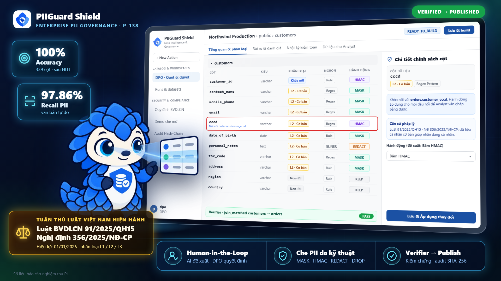

# Pitch Deck & Demo Materials



## Files

| File | Nội dung |
| --- | --- |
| [`pitch_deck.pptx`](pitch_deck.pptx) | Deck Demo Day 9 slide, **bản gốc** để sửa trong PowerPoint/WPS/Google Slides; có speaker notes từng slide |
| [`pitch_deck.pdf`](pitch_deck.pdf) | Bản PDF xuất từ `pitch_deck.pptx`, dùng để nộp hoặc chiếu khi máy không có PowerPoint |
| [`thumbnail.png`](thumbnail.png) | Ảnh bìa 1920×1080 cho video demo và gallery dự án: màn DPO review trên monitor, Pango chỉ vào màn hình, badge số liệu nghiệm thu P1 |
| [`source/build_deck.js`](source/build_deck.js) | Script dựng thumbnail và một bản deck theo màu app (9 slide); **không phải** nguồn của deck hiện tại |
| [`video/`](video/README.md) | Video demo khoảng 3:25 dựng bằng HyperFrames: lời đọc TTS tiếng Việt, phụ đề tiếng Anh, cảnh app quay bằng Playwright; cách xem trước và quay lại ở README trong thư mục |

Link video demo đã xuất và app live nằm ở [README gốc](../README.md).

## Cấu trúc deck

1. **PIIGuard Shield** — bảo vệ dữ liệu cá nhân theo Luật 91/2025/QH15, giữ nguyên giá trị phân tích; 4 cách bảo vệ MASK · REDACT · HMAC · DROP
2. **Vấn đề** — Luật 91, NĐ 356/2025, NĐ 330/2026 và mức phạt tối đa; bỏ sót PII, che sai làm hỏng JOIN, thiếu bằng chứng
3. **Giải pháp** — cổng bảo mật giữa database gốc và Analyst; DPO chọn 1 trong 4 cách bảo vệ cho từng trường
4. **Sản phẩm** — 7 bước Kết nối → Chọn phạm vi → Quét → DPO duyệt → Build → Kiểm chứng → Publish, hai cổng kiểm soát
5. **Kiến trúc** — đường dữ liệu, đường điều khiển và 3 lớp kiểm soát (chỉ đọc nguồn, che trên bản sao riêng, kiểm chứng trước khi chia sẻ)
6. **AI / LLM** — phễu rules → BM25 → hybrid vector → LLM vùng xám; số liệu Luồng A/B sau HITL
7. **Kỹ thuật** — tests, CI/CD, nhật ký chuỗi hash SHA-256
8. **Bài học** — giữ JOIN bằng HMAC, dùng LLM mà không lộ PII, giới hạn ngoại lệ `KEEP`
9. **Team & lộ trình** — 4 thành viên, 4 hướng phát triển, lời cảm ơn

Số liệu test/benchmark là số của báo cáo nghiệm thu P1 và được ghi chú như vậy trên slide.

## Nhận diện (Brand DNA)

Theo [`assets/svg/piiguard-brand-dna.svg`](../assets/svg/piiguard-brand-dna.svg): nền `#F8FAFC`, gradient `#0F172A → #0F766E → #16A34A`, card trắng bo 22px, màu ngữ nghĩa Verified `#16A34A` / Warning `#D97706` / Blocked `#DC2626`. Mascot Pango và logo lấy từ [`assets/`](../assets/README.md). Font Arial để chiếu ổn định trên mọi máy.

## Cập nhật deck

Từ bản Demo Day, deck được sửa trực tiếp trong `pitch_deck.pptx`. Sau mỗi lần sửa, xuất lại PDF để hai bản khớp nhau, ví dụ bằng LibreOffice:

```bash
cd presentation
soffice --headless --convert-to pdf pitch_deck.pptx   # ghi đè pitch_deck.pdf
```

Hoặc dùng "Export / Save as PDF" của PowerPoint/WPS. Mở PDF xem lại từng trang để chắc không có chữ tràn khung.

**Không chạy `npm run build` trong `source/`**: script sẽ ghi đè `pitch_deck.pptx`, `pitch_deck.pdf` và `thumbnail.png` bằng bản deck theo màu app. Nếu cần dựng lại thumbnail, commit deck trước, chạy build, rồi `git checkout -- pitch_deck.pptx pitch_deck.pdf` để lấy lại deck và chỉ commit `thumbnail.png`.

Không đưa raw PII, sample value hay secret lên slide.

## Video Demo Checklist

- [ ] Giới thiệu problem (< 30 giây)
- [ ] Demo live feature chính (2-3 phút)
- [ ] Hiển thị kết quả AI (1 phút)
- [ ] Tóm tắt impact (< 30 giây)
